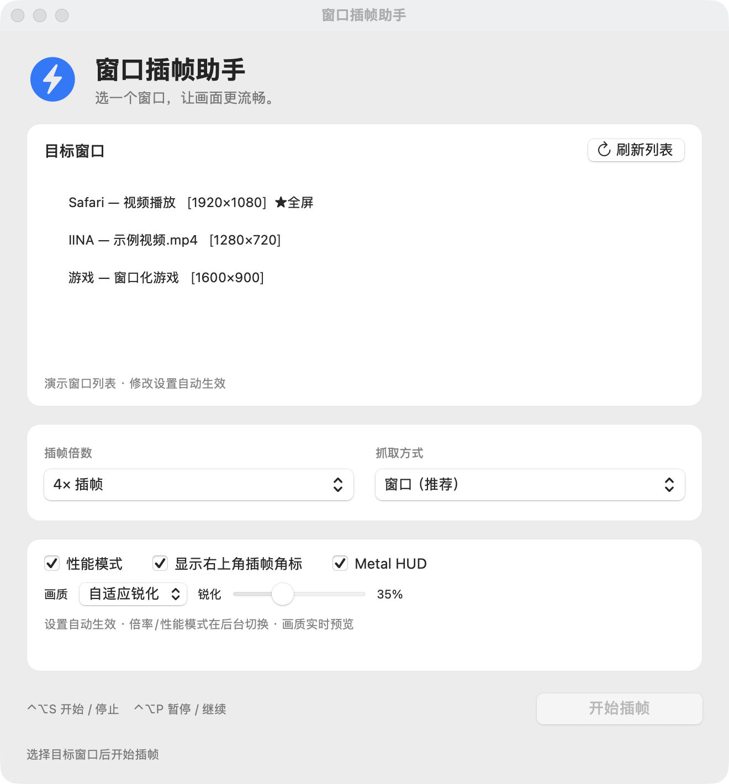

# 窗口插帧助手 · WindowInterp

给 macOS 窗口添加 LSFG 插帧。浏览器视频、播放器、窗口化应用或游戏都可以选择为源窗口，输出覆盖层跟随源窗口的位置和大小，键鼠输入穿透到原应用。

**Apple Silicon / macOS 15+** · [下载最新版本](https://github.com/lrylnx/WindowInterp/releases/latest)

## 新版界面



窗口列表使用演示数据；截图展示 v1.4.2 的实际控制窗与实时画质调节（锐化强度旁显示当前百分比）。

## 使用

1. 打开应用，授予「屏幕录制」权限，按系统提示重新打开应用。
2. 在控制窗的列表中选中目标窗口。新窗口未出现时，点「刷新列表」。
3. 选择插帧倍数和抓取方式，点「开始插帧」。
4. 使用悬浮条或 `⌃⌥S` 停止；`⌃⌥P` 暂停 / 继续。

控制窗关闭或最小化后，点击 Dock 图标即可重新显示；也可以通过菜单栏 ⚡ 打开。打开控制窗时读取一次窗口列表，平时不在后台持续枚举全部窗口，避免无用的 CPU 与 WindowServer 开销。

## 控制项

| 控制项 | 作用 |
| --- | --- |
| 刷新窗口列表 | 按需读取可采集窗口，包含其他桌面空间；优先显示全屏窗口 |
| 插帧倍数 | 手选 2×、3×、4×、5×、6×、8×、10×、12×。5× 以上需要扩展引擎 |
| 抓取方式 | 窗口（推荐），或整屏采集并排除本工具自己的窗口 |
| 性能模式 | 使用轻量着色器降低 GPU 开销，后台自动切换引擎 |
| 画质 | 原始画质、自适应锐化（CAS），运行中实时切换 |
| 锐化强度 | 0–100% 连续调节并显示百分比，0 时跳过锐化处理；建议从 20–40% 开始 |
| 右上角插帧角标 | 显示状态及帧率；鼠标静止 3 秒后隐藏，在输出区域移动后恢复 |
| Metal HUD | 实时开关 Apple 原生 Metal 性能面板，显示帧率、GPU 耗时等数据 |

**v1.4.1：撤掉 v1.4.0 里两个「永远不生效」的画质项。** 用户在真机实测「几乎没有任何区别」，查下去发现它们是**死档** —— 本工具的采集尺寸**恒等于**输出尺寸，而「Lanczos 重采样」「MetalFX 空间放大」「按屏幕分辨率重建」都要以「输出 > 采集」为前提，那个前提**永远不成立**，于是它们与「原始画质」**逐像素完全相同**。已全部移除（v1.4.0 里那个真正的修复 —— 产物最低系统要求从 macOS 27 降到 macOS 15 —— 保留）。

**v1.3.0：修改设置不再重启应用。** 控制窗口与后台引擎分离。倍率、性能模式和抓取方式变化时，后台预热新引擎，确认实际生成帧后才交接；旧引擎在此期间继续输出。准备时间取决于分辨率与倍率，通常需要数秒。连续修改会合并为最后一次选择；失败时保留原引擎并显示原因。未开始时只保存设置，不创建引擎。

画质、锐化强度、Metal HUD 和角标通过管道实时更新，不创建新引擎。暂停 / 停止悬浮条也会在鼠标静止 3 秒后隐藏，隐藏时不会挡住源窗口的鼠标操作。暂停时停止采集和渲染，保留最后一帧。

**为什么这里没有「放大 / 超分」档（FSR、MetalFX、DLSS 那一类）**：这类算法的前提是「先拿到一张低分辨率画面，再把它重建到高分辨率」，而在本工具里采集尺寸**就是**输出尺寸 —— `源窗口尺寸 × 屏幕缩放因子`，并被面板物理像素封顶。也就是说**画面本来就是 1:1 原生像素，没有任何放大空间**，任何上采样都无事可做。要让它们有活干，只能先**故意压低采集分辨率**（小黄鸭那个 FSR 档就是这么用的），但那是拿画质换性能，方向正好相反。

还有一层：如果源窗口里播的本来就是低清内容（比如 720p 视频铺满全屏），那点细节在源 App 把画面交出来之前就已经没了 —— 加什么滤镜都补不回来。所以这里能做的只剩**后处理**，目前是 CAS 对比度自适应锐化：按局部对比度自动收强度，纯色区域几乎不动、低对比区域才用力，所以不像普通锐化那样在强边缘出黑边白边。

**固定配置**：光流精度 1.0、采集上限 60fps、工作分辨率跟随面板像素。不提供精度、采集上限、工作分辨率、自动倍率或上下颠倒的设置；旧偏好中的对应值不会改变当前配置。60fps 是采集上限，实际采集帧率取决于源窗口、屏幕和引擎。

## 倍率与边界

**v1.4.2：修掉几处会「看着像卡住」的状态竞争。** 渲染端等到真正可用的 drawable 再取最新帧 —— GPU 繁忙时不再呈现已经过期的画面，也不会丢掉最后一帧后无人唤醒；拖动 / 缩放源窗口后，5 秒兜底检查读实时坐标（此前复用启动时的缓存，窗口会突然跳回旧位置）；重复「继续」和快速「暂停」不再互相覆盖，暂停请求带版本标记，旧状态消息不能盖住新操作；控制进程写引擎管道改为串行后台队列并关掉多余读端，引擎无响应时控制窗仍可操作。恢复采集或切换引擎时重新读取源窗口尺寸与所在屏幕，目标窗口关掉会提示并停止。CAS 编码失败回退原始画面，GPU 提交失败会提示并停止会话。详见 [本机验证记录](dev/本机优化与验证-2026-10-19.md)。

60Hz 内建屏建议从 **2×、窗口采集** 开始；GPU 吃紧时打开性能模式。需要增强软细节时选自适应锐化，先用 20–40%。倍率越高并不等于越流畅，应结合实际源帧率和屏幕刷新率选择。

优先选择「源内容帧率 × 倍率」接近屏幕刷新率的倍率。例如 30fps 内容配 60Hz 屏可选 2×；源已经接近屏幕刷新率时，插帧通常没有收益。高倍率增加延迟，也会增加快速运动、遮挡、字幕和切镜头处的伪影。

- 源窗口需要持续渲染。切到别的桌面空间后，系统可能冻结源内容，切回即可恢复。
- 光标与输入由原应用管理；画面仍有插帧的等待延迟。
- 声音在原应用播放，插帧延迟可能产生音画不同步。
- 不支持 DRM 保护画面；输出为 SDR / 8-bit，不处理 HDR。
- LSFG 引擎按主屏刷新率排程，建议将需要插帧的窗口放在主屏。

## 构建

```sh
zsh make-identity.sh   # 首次生成本机签名证书
zsh build.sh
```

构建脚本从本机「LSFG 视频播放器.app」、已安装的「窗口插帧助手.app」或「MetalFrame.app」读取引擎资源，找不到时复用已有 App 内的资源；也可通过 `LSFGM_LSFG_SOURCES` 指定以冒号分隔的目录。专有引擎二进制不在源码仓库中。`make-identity.sh` 优先恢复 `signing/identity.p12` 中已有的本机证书，避免换机重建时生成另一份身份。固定本机签名证书有助于重建后维持应用身份；屏幕录制权限以系统实际授权状态为准。

当前优化与 GitHub 调研见 [开发记录](dev/开发笔记.md)（含 FSR4 / Magpie 调研、MetalFX 落地与离线画质 A/B）与 [v1.3.0 验证报告](dev/优化与验证-2026-10-15.md)。

验证命令（需要 Xcode；动态验证还需要屏幕录制权限）：

```sh
zsh dev/verify-local.sh
xcrun swiftc -O dev/testpattern.swift -o dev/testpattern
python3 dev/verify-live-settings.py
mkdir -p dev/verification-overlay
xcrun swiftc -O dev/verify-overlay.swift -o dev/verification-overlay/verify-overlay
dev/verification-overlay/verify-overlay "$PWD/窗口插帧助手.app"
```

`verify-local.sh` 会**就地抽取**源码里真实的 `CASPass` 来跑离线检查（不需要屏幕录制权限）：CAS 的零强度恒等与锐化响应。另外还有一条**源码级**判据 —— 断言「画质」下拉里的档**只允许是在 1:1 下也真实生效的**，谁再往里加"放大档"会当场变红（v1.4.0 正是漏了这条，让两个死档一路发到了用户手上）。

动态验证覆盖真实 LSFG 生成、2×/3×/4×/12×、性能模式、画质热更新、暂停恢复及暂停中切换倍率、整屏切换、连续修改、失败回退及进程清理；验证后恢复原偏好。窗口跟随验证单独运行，覆盖暂停期间移动和缩放、恢复后跨越多个 5 秒检查周期的坐标一致性。`--in-process` 保留单进程诊断路径，不用于日常操作。

开发记录、历史实验与测量工具见 `dev/`。历史笔记描述的是当时的版本，当前控制项以上述列表为准。

## 第三方来源与许可

| 组件 | 来源 |
| --- | --- |
| `liblsfg_metal.dylib` / `lsfg-vk.dll` | 本机 `MetalFrame.app`（运行日志显示 LSFG **v0.8.0**；`lsfg-vk.dll` 的版本资源写着 Lossless Scaling **3.2.2.0** —— 历史文件的版本信息，未据此推断当前零售版） |
| `liblsfg_extended.dylib` | 同上，5–12× 用的二进制补丁版；**非上游支持版本** |
| `libMoltenVK.dylib` | [KhronosGroup/MoltenVK](https://github.com/KhronosGroup/MoltenVK) |

LSFG 引擎与着色器包属于专有组件，本项目**只在本机使用现有文件**，
没有取得对应源码或完整许可证文本，**公开分发这些二进制可能有问题**。

## 免责

按「现状」提供，不附带任何担保。请只对你有权观看的内容使用插帧。

---

> 更多开发与测量细节（设计依据、验证方法、工具用法）见 `dev/` 目录。
