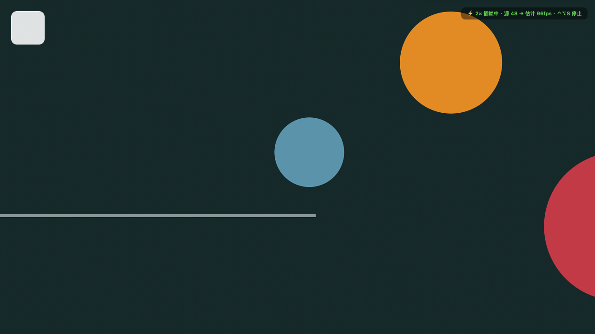
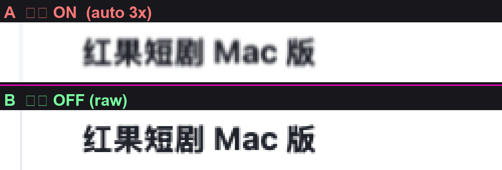
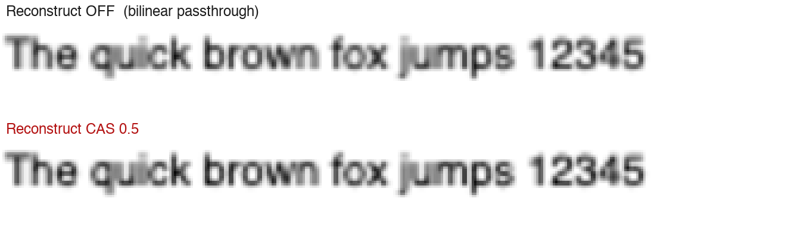

# 窗口插帧助手 · macOS

给**任意窗口**做 LSFG 插帧：浏览器网页视频、别的播放器、甚至游戏，都能抓下来插帧，
再把插帧后的画面**精确贴回那个窗口**给你看 —— 窗口是全屏，覆盖层就是整屏；窗口是
窗口化的，覆盖层就只盖住它自己。

- **源窗口一个字都不动**：覆盖层点击穿透，鼠标/键盘根本不经过本工具，光标由系统合成、天然跟手。
- **全屏视频更像视频**：满屏只剩画面，不会被迫露出地址栏、书签、弹幕、评论。
- **窗口化游戏也能用**：覆盖层只盖住那个窗口，桌面其余部分照常能用。

技术来自 LSFG 视频播放器（同一个引擎、同一条 Metal 渲染管线），但取景方式完全不同 ——
抓的是**窗口**，看的也是**另一个窗口**。

**下载**：[最新版本](https://github.com/lrylnx/WindowInterp/releases/latest)　·　解压即用，Apple Silicon / macOS 15+

## 效果

### 插帧运行中：覆盖层精确贴住源窗口，角标实时显示「源 X → 估计 Y fps」



### 控制窗：选目标窗口、倍率、抓取方式、采集上限、输出重建档


### 画质：插帧 ON vs 原帧

帧插值必然有代价 —— 显示帧里约 2/3 是算出来的，文字这种空间频率最高的内容最先暴露。
下面是把同一个窗口标题放到 5× 看的对比（上=插帧，下=原帧）：



### 输出重建：把「被放大糊掉」的笔画重新收出边缘

`Lanczos` 重采样 + 对比度自适应锐化（CAS）（上=关闭，下=CAS 0.5）：



### 工作流程


## 用法

1. 打开本工具（菜单栏 **⚡** 图标，或 Dock），在「选择目标窗口」里选中要插帧的窗口
   （列表每 5 秒自动刷新，也有「刷新窗口列表」；会标出 **★全屏**，别的桌面空间里的
   窗口也会列出来并标注「其他空间」）。
2. 点「开始插帧」。本工具会**自动切到源窗口所在的那个桌面**，并把覆盖层**贴住那个窗口**。
   - **全屏源**（浏览器视频全屏、播放器按 F、全屏游戏）：覆盖层 = 整屏，满屏只剩视频。
   - **窗口化源**（窗口化游戏、普通 App）：覆盖层只盖住那个窗口，桌面其余部分照常能用。
   - 源窗口**不用**先全屏，也不用改任何浏览器设置。
3. 看角标确认状态：`⚡ 2× 插帧中 · 源 40 → 出 120fps · ⌃⌥S 停止`。窗口正上方还有一个
   **控制小窗**（可见可点，不会被穿透），上面有「暂停 / 停止插帧」按钮。
4. 退出：`⌃⌥S`，或点控制小窗上的「停止插帧」，或菜单栏 ⚡ 里的对应项。
   退出后源窗口**原样**继续播（我们没动过它）。

### 输入与光标

覆盖层是**点击穿透**的，所以：

| 操作 | 作用 |
| --- | --- |
| 鼠标 / 键盘 | **完全不经过本工具**，直达源窗口（游戏能玩、视频能拖进度条、网页能选中文字） |
| 光标 | 由系统合成在所有窗口之上，从不经过插帧管线 ⇒ **天然跟手** |
| 控制小窗（源窗口上方） | 「暂停 / 继续」「停止插帧」—— 独立小窗，不穿透，可见可点 |
| 菜单栏 **⚡** | 全部设置 + 开始/停止 + 倍率 |
| `⌃⌥S` / `⌃⌥P` / `⌃⌥Q` | 开始停止 / 暂停继续 / 退出（全局热键，源窗口全屏时也有效） |

**注意**：因为不抢键盘，`Esc` 是**源窗口的**（按 `Esc` 退的是视频全屏 / 游戏菜单，
不是本工具的插帧）。要停插帧请用 `⌃⌥S`、控制小窗或菜单栏。

### 快捷键（全局，不需要辅助功能权限）

| 快捷键 | 作用 |
| --- | --- |
| `⌃⌥S` | 开始 / 停止插帧 |
| `⌃⌥P` | 暂停 / 继续 |
| `⌃⌥R` | 刷新窗口列表 |
| `⌃⌥Q` | 退出 |

## 倍率

### 自动倍率（默认开启，推荐）

菜单栏 ⚡ 、控制窗复选框、倍率下拉框第一项三处都能开关。

它解决的是「**没有全能倍率**」这件事：同一块 144Hz 屏上，最合适的倍率随源帧率变
（24fps 视频要 6×、60fps 游戏要 3×、70fps 源 2× 就够），手选一个固定值不可能一直对。

**两段式**（倍率是引擎的进程级参数，换档 = 重启一次进程，会自动接回同一个窗口）：

1. **探测**：先用 2× 跑 10 秒，量出源窗口真实帧率。画面太静（量不出帧率）就**保持 2× 继续等**，
   绝不硬猜 —— 每 30 秒重试一次。
2. **规划**：按「输出帧率贴近刷新率 + 节奏整除 + 源信息损失 + 延迟」打分排出阶梯，先试首选那档。
3. **验证**：跑一段后用**引擎自己的遥测**判定是否达标（输出没到规划值 / 节奏抖动 >15% /
   引擎丢帧）—— 不达标就往下降一档。**样本不够就不动手**（读不到 ≠ 没问题）。

排出来的阶梯是**单调降档**的，所以「效果不好就降档」不会被走成「越降越激进」。

离线看它会怎么选（不会开窗、不动引擎）：

```bash
./窗口插帧助手.app/Contents/MacOS/WindowInterp --auto-dry-run --source-fps 60 --refresh-hz 144
```

⚠️ **手选任何一档倍率即视为放弃自动**（包括命令行 `--multiplier`）。

⚠️ **高倍率下「源内容换没换」测不出来**（采集上限把源帧率钳住了，两边读数一样）——
源从视频切到游戏时，点菜单里的「自动倍率 ⟳ 立即重新探测源帧率」手动重探一次。

可调参数（都在命令行；会跟着换档重启一路传递下去）：

| 参数 | 默认 | 作用 |
| --- | --- | --- |
| `--no-auto-multiplier` | — | 关掉自动，回到手选倍率 |
| `--auto-max N` | 不限 | **封顶倍率**。嫌高倍率补帧痕迹重就设 `--auto-max 3`（24fps 视频会从 6× 落到 3×） |
| `--auto-probe S` | 10 | 探测轮时长（秒）。源帧率不稳时调大 |
| `--auto-credit N` | 6 | 一条链最多重启几次（额度用尽就保持当前档，不会无限试） |

### 手选倍率

倍率是**引擎进程级**参数，改了会重启本应用（会自动接着播）。
菜单和下拉框里每一项都标了**实测延迟**（按当前输出屏的刷新率估）。

按「源帧率 × 倍率 ≈ 屏幕刷新率」选，超了没有收益还会丢源帧：

| 源 | 60Hz 屏 | 144Hz 屏 | 自动倍率会选 |
| --- | --- | --- | --- |
| 24fps 视频 | 2×（48） | 2×/3× | **6×**（144，零抖动零损失；嫌补帧痕迹重就设 `--auto-max 3`） |
| 30fps 视频 | 2×（60，正好） | 4×（120） | 5×（144） |
| 40fps | 2× | 3×（120，抖动 20%） | **4×**（144，抖动 0） |
| 60fps 游戏 | 无收益（屏幕只有 60） | 2×（120，抖动 20%） | **3×**（144，抖动 0） |

⚠️ **60Hz 屏上别超过 2×**：60Hz 主屏上 2× 约 50ms，3× 直接跳到约 185ms。
**144Hz 高刷屏上完全换了一个世界**：2×/3×/4× = 21/28/35ms，3× 也可用。

5× 及以上用扩展引擎（`liblsfg_extended.dylib`）。HUD 里会显示当前屏幕刷新率。

## 抓取方式

| 方式 | 说明 | 什么时候用 |
| --- | --- | --- |
| **窗口**（默认） | 抓那个窗口自己的内容，和它在哪个空间无关 | 首选。浏览器视频、播放器、绝大多数游戏 |
| **整屏** | 抓整块屏幕，**排除本工具自己的窗口**（所以不会自我镜像）；画面裁剪到目标窗口区域 | 窗口抓取抓不到内容的极少数情况（某些游戏 / 受保护窗口） |

整屏方式更适合「源窗口和输出窗口在同一个空间」的场景：跨空间时源窗口不在渲染，会抓不到。

## 输出重建（画质增强）

插帧之后还有**第二个、完全独立的糊源**：画面送进 `CAMetalLayer` 的最后一步默认是一次
GPU 驱动的双线性缩放。输出重建就是把这一步换成 `Lanczos` 重采样，再叠一道
**CAS（Contrast Adaptive Sharpening，对比度自适应锐化）**。

| 档 | 做了什么 | 什么时候用 |
| --- | --- | --- |
| **关闭**（默认） | 双线性直通 | 不想要任何新行为就用它 |
| **Lanczos** | 把链尾的隐式双线性换成 Lanczos 重采样 | 只在「输出尺寸 ≠ 采集尺寸」（放大那一路）才有区别 |
| **CAS** | Lanczos + 一道 CAS 锐化片元 pass | 源画面已经很糊、想把清晰度拉回来 |

强度（默认 0.5）是 `CAS` 档专用的，`0` 就是恒等。在**控制窗「性能」那一行最后一个下拉**、
或**菜单栏 ⚡ → 输出重建**里选，**改档不用重启**。

**实测效果**：锐化让画面平均梯度 / 高频能量 **+15~19%**（输出=采集尺寸时）到 **+30~56%**
（发生放大时）；Lanczos 相对双线性的重采样收益 **+17% / +28%**。代价是生产路径多花
**约 +0.3 W GPU 功耗**（+11~14%）。输入、跟随、点击穿透、快捷键一律不受影响。

### 一个必须搞清楚的认知：源窗口本来就铺满屏幕时，只有「锐化」那半起作用

「放大重建」听起来像把 720p 拉到 1440p。但**最主流的场景恰恰不需要放大**：源窗口
（浏览器全屏视频、播放器、游戏）**本来就铺满屏幕**，我们采到的画面已经是源 App 自己
（或 WindowServer）用双线性放大过一遍的结果了。这时 `输出尺寸 == 采集尺寸`，
**不发生重采样** ⇒ `Lanczos` 档与「关闭」画面完全一致，`CAS` 档里**只有锐化在干活**。

别指望分辨率变高 —— 指望的是「糊掉的笔画重新收出边缘」。想让输出尺寸真的大于采集尺寸，
得先做「自动把源窗口拉到整屏」那一档（**还没做**，需要辅助功能权限）。

### CAS 是什么，为什么不用现成的滤镜

`CIUnsharpMask` / `CISharpenLuminance` 这类是**固定强度**的高通增强，会连同强边缘一起加力
⇒ 白边/黑边（光晕）。CAS 的关键是那个**按局部对比度自动把强度压下去**的项：

```
amp  = sqrt(saturate( min(邻域最小, 1−邻域最大) / max(邻域最大, 1e-5) ))
结果 = 原值 + amp × 强度 × (原值 − 八邻域均值)
```

纯色区 `amp ≈ 0`（几乎不动），只有**低对比**（= 被双线性糊掉的笔画内部）才用力。

### 画质：插帧**一定**会让文字变糊（这不是 bug）

引擎自己的统计就说明了一切：`generated=836 / total=1256` ⇒ **66.6% 的显示帧是算法生成的**
（3× 就是每 3 帧里 2 帧是插出来的）。每个生成帧都是「按估计运动重采样」的结果，而
**文字是画面里空间频率最高的内容**，最先暴露、最明显 —— 所以「看字体」是最灵敏的判据。

**生成帧占比就是清晰度的反面**（这也是画质侧唯一能调的旋钮）：

| 倍率 | 1×（关） | 2× | 3× | 5× |
| --- | --- | --- | --- | --- |
| 生成帧占比 | 0% | 50% | 66.6% | 80% |

- 看字 / 读文档 → 关掉插帧（原帧模式），零损失；
- 想保丝滑又想少糊 → `--auto-max 2` 封顶（生成帧占比 66.6% → 50%），代价是输出帧率降一档。

### ⚠️ 什么源「不该」开插帧

插帧的收益公式：**源帧率 × 倍率 ≈ 屏幕刷新率** 才有收益。反过来：

- **源已经满帧 / 接近满帧时，开插帧一定更卡**。真实满帧游戏/桌面动画请直接关插帧。
- **24fps 视频内容**（短剧等）：有收益，但注意高倍率的代价 —— 采集会被钳到 `刷新率÷倍率`，
  内容只有 24fps 时采集帧里一半是重复帧，观感提升打折。
- **文字/文档场景**：见上一节，插帧一定会让字变糊。

## 延迟

插帧是拿「两帧都到手」才算得出中间帧的，所以**必然**有一个采集帧的等待；倍率越高、
引擎的源帧率被压得越低，延迟就越大。用标尺相对位置法实测（Apple M4 / 光流 0.5）：

| 倍率 | 60Hz 主屏（内建） | 144Hz 主屏（外接） |
| --- | --- | --- |
| 不插帧（原帧模式） | **20 ms** | **14 ms** |
| 2× | **50 ms** | **21 ms** |
| 3× | **185 ms** | **28 ms** |
| 4× | **285 ms** | **35 ms** |

三条定案结论：

1. **144Hz 上延迟 =（倍率＋1）个刷新周期**（2×/3×/4× = 21/28/35ms，严丝合缝）。
   60Hz 屏上源帧率被压到 20fps 以下、流水线进入「饥饿区」，延迟才会 50 → 185 → 285 暴涨。
2. ⚠️ **引擎按「主屏」刷新率排程，不是输出窗口所在的那块屏**。输出放在 60Hz **副屏**时
   2× 会多吃约 60ms 惩罚（117ms vs 主屏 50ms）⇒ **要插帧的窗口尽量放主屏**。
3. ⚠️ **延迟数字好 ≠ 任何源都该开**。源已经满帧时开插帧**必然更卡**（输出被钳、帧间隔抖动、
   光流伪影、白付延迟）。低帧源（24–48fps）才是插帧的目标场景。

诚实的代价：**键鼠/光标跟手，但画面里的准星/视角仍会随插帧多 1–2 帧**（小黄鸭 2× 同样如此）。
声音在你原来那个窗口里继续播，本工具只搬画面 —— 所以音画不同步 = 插帧延迟本身。

## 功耗与省电

这个工具比视频播放器费电得多，原因**不是**引擎不一样（同一个引擎、同一条管线），
而是**工作面积**。为此默认做了封顶：

| 配置 | GPU 功耗 | 净开销 |
| --- | --- | --- |
| 基线（画面在动，不插帧） | 0.16 W | — |
| 按「逻辑尺寸 × 2」采集（旧行为，缩放下会远超面板像素） | **5.30 W** | 5.14 W |
| 封顶到面板像素（现在默认） | **3.12 W** | 2.96 W |
| 面板像素 + 光流 0.5（省电档） | **0.97 W** | 0.81 W |

→ **默认配置比原来省约 41%**；再叠光流 0.5 可到 **省约 82%**。

### 四个开关（菜单栏 ⚡ 和控制窗里都有）

| 开关 | 默认 | 说明 |
| --- | --- | --- |
| **插帧工作分辨率** | 跟随面板像素 | 采集尺寸**封顶到显示器物理像素**。这一项是**无损**的：屏幕本来只有这么多像素，多采的部分最终都会被丢掉 |
| **光流精度**（`LSFGM_FLOW_SCALE`） | 1.0 | 引擎的算力大头。光流计算量随分辨率**平方**增长，降到 0.5 就能让 GPU 从 3.12 W 掉到 0.97 W。视频上肉眼几乎看不出差别；只有细密文字 / 高频纹理画面才可能有瑕疵 |
| **性能模式（轻量着色器）** | 关 | 引擎换一套便宜得多的着色器。实测同一条 3× 插帧下 GPU **3.40 W → 0.99 W**，而**生成帧数一张不少**。代价是插值画质略有让步，在意画质就别开 |
| **采集帧率自动匹配屏幕** | 开 | 把采集上限压到「屏幕刷新率 ÷ 倍率」。60Hz 屏 + 2× 时源只要能到 30fps 就够，多采的帧引擎生成出来也显示不出来 |

改「工作分辨率」只影响采集参数，会**自动重开一次插帧**；改「光流精度」和「性能模式」都是
引擎的进程级环境变量，只能在进程启动那一刻注入，所以会**重启进程**（菜单会自动重启并接着播）。

#### 性能模式实测（本机 M4 / 源 1920×1080 / 3× / 光流 1.0，各两轮）

| | GPU 功耗 | 生成帧数（engine `source=480` 时） |
| --- | --- | --- |
| 关（默认 · 画质优先） | 3.40 / 3.10 W | 958 |
| 开（轻量着色器） | 0.99 / 1.03 W | 958 |

→ GPU 降到约 **1/3**，而**帧一帧都没少**。原因是这个工具的输出被屏幕刷新率定速
（一秒能上屏几张由 `vblank` 决定），引擎算得快慢不改变出帧数量，只改变**耗多少电**。

⚠️ **它省的是电，不是延迟**（延迟由倍率和刷新率决定，见「延迟」章节）。
源本来就只有 1080p 出头时收益已经很明显；分辨率越高、倍率越大，省得越多。

## 已知边界（说实话）

- **源窗口必须自己在动。** 静态画面本来就不出帧（这很正常）；但如果源窗口看不见时
  浏览器主动把视频渲染停掉（部分站点会），插帧就会停。源窗口处于**原生全屏 Space 且
  该 Space 就是当前 Space** 时，Chrome / 播放器都实测持续出帧。
- **源窗口不能离开当前 Space。** 一旦被切走（用户四指滑到别的桌面），系统会冻结它的内容，
  画面立刻卡住。四指滑回去就恢复；启动后 20 秒内本工具还会自己尝试把 Space 切回来。
- **`F` 键切全屏是无效的**（有意为之）：我们已经是贴住源窗口的覆盖层，再切原生全屏会把
  源窗口挤到别的 Space、源立刻停渲染。
- **插帧会带来延迟，且随倍率变大**（见「延迟」章节）。60Hz 屏玩游戏只敢开 2×；
  144Hz 主屏 2×/3× 都可玩。要操作的窗口尽量放**主屏**。
- **输出重建不会提高分辨率**，它只补「糊」的那一半（见「输出重建」章节）。当前只做了
  `Lanczos` + `CAS`；更贵的 MetalFX Spatial / Anime4K 还没落地。
- **60Hz 屏上 60fps 源插帧没有收益**（引擎按 vsync 定速，输出不会超过刷新率）。
- 倍率过高（源帧率 × 倍率 > 屏幕刷新率）时引擎会丢源帧。
- 不支持 DRM 保护的画面（Netflix 等会抓到黑屏）。
- HDR 不处理，显示链路是 SDR / 8-bit。
- 快速运动、遮挡、切镜头、字幕处可能出现插帧伪影，倍率越高越明显。

## 屏幕录制权限（只授权一次）

必须授予「屏幕录制」权限才能枚举/采集窗口。

本 App 用一张**本机自签代码签名证书**签名（`make-identity.sh` 生成，存在独立钥匙串
`~/Library/Keychains/windowinterp.keychain-db`），所以 designated requirement 是固定的 ——
**重新构建、重装都不会再问权限**。

第一次运行：菜单栏 ⚡ → 「⚠️ 打开「屏幕录制」权限设置」→ 勾上「窗口插帧助手」→
重新打开本应用。

## 构建

```sh
zsh make-identity.sh   # 只需跑一次：生成自签证书并放进独立钥匙串
zsh build.sh
```

`build.sh` 会从桌面的「LSFG 视频播放器.app」（或 MetalFrame.app）取引擎资源
（`liblsfg_metal.dylib` / `liblsfg_extended.dylib` / `libMoltenVK.dylib` / `lsfg-vk.dll`）。
这些专有资源不在本仓库里，所以重新构建需要本机已有那个播放器。

签名**不加** `--options runtime`：Hardened Runtime 会拦下 `DYLD_INSERT_LIBRARIES`，
LSFG 引擎就注入不进去了。

## 第三方来源与许可

| 组件 | 来源 |
| --- | --- |
| `liblsfg_metal.dylib` / `lsfg-vk.dll` | 本机 `MetalFrame.app`（运行日志显示 LSFG **v0.8.0**；`lsfg-vk.dll` 的版本资源写着 Lossless Scaling **3.2.2.0** —— 即当前最新零售版） |
| `liblsfg_extended.dylib` | 同上，5–12× 用的二进制补丁版；**非上游支持版本** |
| `libMoltenVK.dylib` | [KhronosGroup/MoltenVK](https://github.com/KhronosGroup/MoltenVK) |

LSFG 引擎与着色器包属于专有组件，本项目**只在本机使用现有文件**，
没有取得对应源码或完整许可证文本，**公开分发这些二进制可能有问题**。

## 免责

按「现状」提供，不附带任何担保。请只对你有权观看的内容使用插帧。

---

> 更多开发与测量细节（设计依据、验证方法、工具用法）见 `dev/` 目录。
