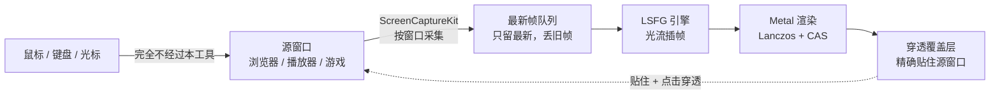

# 窗口插帧助手 · macOS

给**任意窗口**做 LSFG 插帧：浏览器网页视频、别的播放器、甚至游戏，都能抓下来插帧，
并把插帧后的画面**精确贴回那个窗口**给你看（窗口是全屏，覆盖层就是整屏；窗口是窗口化的，
覆盖层就只盖住它自己）。

技术来自本机的 LSFG 视频播放器（同一个引擎、同一条 Metal 渲染管线），
但换了一个完全不同的取景方式——抓的是**窗口**，看的也是**另一个窗口**。

## 效果

### 插帧运行中：覆盖层精确贴住源窗口，角标实时显示「源 X → 估计 Y fps」


### 控制窗：选目标窗口、倍率、抓取方式、采集上限、输出重建档


### 画质：插帧 ON vs 原帧

帧插值必然有代价 —— 显示帧里约 2/3 是算出来的，文字这种空间频率最高的内容最先暴露。
下面是把同一个窗口标题放到 5× 看的对比（上=插帧，下=原帧）：


### 输出重建（档 1）：Lanczos + CAS 锐化

`CapturePipeline.present()` 链尾那道隐式双线性换成 Lanczos 重采样 + 对比度自适应锐化（CAS），
把「被放大糊掉」的笔画重新收出边缘（上=关闭，下=CAS 0.5；强度 0 时与原档**逐像素一致**）：


### 管线



**源窗口一个字都不动**：覆盖层带 `ignoresMouseEvents`，输入直达源窗口，光标由系统合成、天然跟手。

## 改道记录：这条路为什么不能想当然

### 第一版（BrowserInterp）：整屏捕获 + 悬浮层（失败）

| 做法 | 死结 |
| --- | --- |
| 整屏捕获再裁剪到目标窗口 | 源窗口必须一直在屏幕上、坐标一变就错位，还可能把自己的悬浮层一起拍进去（自我镜像） |
| 悬浮层盖在源窗口上 | macOS 判定源窗口「被完全遮挡」，浏览器把视频渲染节流到 ~1fps（黑屏/卡成幻灯片） |

### 第二版：抓窗口 + 独立全屏空间（看着优雅，遇到 Chrome 就死）

抓窗口这半是对的（`SCContentFilter(desktopIndependentWindow:)`，窗口在别的桌面空间也能抓到）。
错的是输出端：把插帧画面输出到**另一个原生全屏 Space**。

看着很优雅（源窗口没被遮挡、四指滑动切空间），但 2026-10-12 被实测推翻：

- 输出窗口一进独立 Space，源窗口就被 WindowServer 标记成 `CGWindowIsOnscreen=false`；
- 源窗口不在当前 Space 时，**系统会冻结它的内容** —— 采集端从第 ~42 帧起再也拿不到
  `complete` 帧，只剩 `.idle`（"这一拍没有新内容"）；
- 现象就是用户报的：**开头 1~2 秒有画面，之后冻住/黑屏**。

关键证据（`~/Library/Logs/WindowInterp/app.log`）：

```
start: ok target=2559 Google Chrome ...
capture: 渲染=25/s (累计 42) luma=69.7 帧状态[complete=42 idle=6]   源窗口[onscreen=false]
capture: 渲染=0/s  (累计 42) luma=69.7 帧状态[complete=42 idle=35]  源窗口[onscreen=false]
capture: 渲染=0/s  (累计 42) luma=69.7 帧状态[complete=42 idle=64]  源窗口[onscreen=false]
```

`luma` 冻在 69.7 就是"画面停在最后一帧"的量化证据（每帧采样 40×40 个点算平均亮度）。

⚠️ **这跟 Chrome 的"省内存模式/节能模式"无关** —— 是 Space 隔离 + 遮挡判定，系统级行为。

### 第三版（现在这版）：贴住源窗口的穿透覆盖层 —— 源窗口一个字都不动

输出是一个**无边框、和源窗口同一个 Space、精确贴住源窗口**的覆盖层窗口，并且
**点击穿透**（`ignoresMouseEvents=true`）：鼠标 / 键盘事件根本不经过我们、直达源窗口，
光标由系统合成在最上层，天然跟手。**源窗口保持它自己的原生全屏不变**（Chrome 视频全屏
= 满屏只剩视频，没有地址栏、书签、弹幕、评论）；源窗口是普通窗口时，覆盖层就只盖住它
自己，桌面其余部分照常能用。

> **2026-10-12 第十三轮：第二种输出方式已删除。** 这里原本还有「覆盖层铺满整块屏 +
> 抢 key」的**非游戏模式**。它只在「源窗口本来就是整屏」这一种情形下有优势，代价却是
> 一整套：抢 key（`Esc` 归我们、源 App 收不到自己的快捷键）、要跟 Chrome 抢光标显隐、
> HUD 和右键兜底菜单都得自己维护、还多一条惰性跟随不到位的路径。贴住源窗口在整屏源上
> **完全等价**（覆盖层同样是整屏），所以那条路被整段删掉了 —— 现在只有这一种输出方式，
> 游戏、视频、桌面窗口通吃。

要成立得同时满足三条，缺任何一条都会变成用户看到的那种「没插帧 / 卡住 / 满屏网页元素」：

| # | 条件 | 不满足时的现象 |
| --- | --- | --- |
| ① | **当前 Space 必须是源窗口所在的 Space** | 源窗口内容被 WindowServer 冻结（采集端只剩 `.idle` 帧）⇒ 画面卡住；覆盖层还落在别的空间，用户根本看不到 |
| ② | 覆盖层 `isOpaque=false` **且** `alphaValue<1`，且经 8-bit 量化后 <255（`0.999`→254 ✅；`0.9999`→255 ❌ 实测失效） | 覆盖层把源窗口完全遮住 ⇒ Chrome 判定「被完全遮挡」而停渲染 ⇒ 同样卡住 |
| ③ | 覆盖层必须**精确贴住**源窗口的 frame | 贴合偏了会露出源窗口的边、或盖到别的窗口上。源窗口拖动/缩放后由 4Hz 的 `followOverlayFrame()` 实时跟回来 |

透光率 0.1%，肉眼不可见；LSFG 引擎不受影响（engine 日志 `generated` 正常）。

> ⚠️ 上一版曾用「把源窗口请出原生全屏 + 再铺满屏幕」来绕开 ①。**那是错误方向，已删除**：
> 请出全屏 = Chrome 立刻露出地址栏、书签、网页元素、弹幕、评论，等于「窗口化插帧」——
> 而用户要的正是**满屏只剩视频**。

#### ① 这一步曾经整条失效，原因值得记住

旧代码用 `CGSGetWindowWorkspace` 拿「源窗口在哪个 Space」。这个函数对**原生全屏**窗口
**稳定返回 0**，于是切 Space 静默失败、覆盖层留在桌面空间。用户看到的现象就是：

- Chrome 全屏界面里**没有**插帧画面；
- 切回桌面，那块插帧窗口又是**卡住**的（源窗口不在当前 Space，内容被冻结）。

改用 `CGSCopySpacesForWindows` 之后一次就对（`源Space=[347] 类型=[4]`、`切换 rc=0`）。
附带：`CGSAddWindowsToSpaces`（把窗口显式搬进某个 Space）在原生全屏 Space 上实测**恒返回
`kCGErrorFailure(1)`**，所以它只当切 Space 失败时的兜底，不当主路径。

## 用法

1. 打开本工具（菜单栏 **⚡** 图标，或 Dock），在「选择目标窗口」里选中要插帧的窗口
   （列表每 5 秒自动刷新，也有「刷新窗口列表」；会标出 **★全屏**，别的桌面空间里的
   窗口也会列出来并标注「其他空间」）。
2. 点「开始插帧」。本工具会**自动切到源窗口所在的那个桌面**，并把覆盖层**贴住那个窗口**。
   - **全屏源**（浏览器视频全屏、播放器按 F、全屏游戏）：覆盖层 = 整屏，满屏只剩视频。
   - **窗口化源**（窗口化游戏、普通 App）：覆盖层只盖住那个窗口，桌面其余部分照常能用。
   - 源窗口**不用**先全屏，也不用改任何浏览器设置。
3. 看角标确认状态：`⚡ 2× 插帧中 · 源 40 → 出 120fps · ⌃⌥S 停止`。窗口正上方还有一个
   **控制小窗**（可见可点，不会被穿透），上面有「暂停 / 停止插帧」按钮。
4. 退出：`⌃⌥S`，或点控制小窗上的「停止插帧」，或菜单栏 ⚡ 里的对应项。
   退出后源窗口**原样**继续播（我们没动过它）。

### 输入与光标：这一版的全部操作

覆盖层是**点击穿透**的，所以：

| 操作 | 作用 |
| --- | --- |
| 鼠标 / 键盘 | **完全不经过我们**，直达源窗口（游戏能玩、视频能拖进度条、网页能选中文字） |
| 光标 | 由系统合成在所有窗口之上，从不经过插帧管线 ⇒ **天然跟手** |
| 控制小窗（源窗口上方） | 「暂停 / 继续」「停止插帧」—— 独立小窗，不穿透，可见可点 |
| 菜单栏 **⚡** | 全部设置 + 开始/停止 + 倍率 |
| `⌃⌥S` / `⌃⌥P` / `⌃⌥Q` | 开始停止 / 暂停继续 / 退出（全局热键，源窗口全屏时也有效） |

**注意**：因为不抢键盘，`Esc` 是**源窗口的**（按 `Esc` 退的是视频全屏 / 游戏菜单，
不是我们的插帧）。要停插帧请用 `⌃⌥S`、控制小窗或菜单栏。

### 快捷键（全局，不需要辅助功能权限）

| 快捷键 | 作用 |
| --- | --- |
| `⌃⌥S` | 开始 / 停止插帧 |
| `⌃⌥P` | 暂停 / 继续 |
| `⌃⌥R` | 刷新窗口列表 |
| `⌃⌥Q` | 退出 |

### 倍率怎么选

**默认交给「自动」**（下拉框/菜单第一项，见下一节）—— 它会按源窗口真实帧率算一遍再定。
想手选也行：倍率是**引擎进程级**参数，改了会重启本应用（会自动接着播）。
菜单和下拉框里每一项都标了**实测延迟**（按当前输出屏的刷新率估）。

手选时按「源帧率 × 倍率 ≈ 屏幕刷新率」选，超了没有收益还会丢源帧
（⚠️ 这张表是**旧的手选经验**，它的结论已被第十一轮的自动倍率取代 ——
真正的判据是「输出的帧率节奏是否整除刷新率」，见 `dev/自适应倍率-2026-10-12.md`）：

| 源 | 60Hz 屏 | 144Hz 屏（手选粗估） | 自动倍率会选 |
| --- | --- | --- | --- |
| 24fps 视频 | 2×（48） | 2×/3× | **6×**（144，零抖动零损失；嫌补帧痕迹重就设 `--auto-max 3`） |
| 30fps 视频 | 2×（60，正好） | 4×（120） | 5×（144） |
| 40fps | 2× | 3×（120，抖动 20%） | **4×**（144，抖动 0） |
| 60fps 游戏 | 无收益（屏幕只有 60） | 2×（120，抖动 20%） | **3×**（144，抖动 0） |

⚠️ **60Hz 屏上别超过 2×**：60Hz 主屏上 2× 约 50ms，3× 直接跳到约 185ms（见「延迟」章节）。
**144Hz 高刷屏上完全换了一个世界**：2×/3×/4× = 21/28/35ms（实测），3× 也可用。

5× 及以上用扩展引擎（`liblsfg_extended.dylib`）。HUD 里会显示当前屏幕刷新率。

## 自动倍率（按窗口帧率自适应，2026-10-12 第十一轮）

**默认开启**。菜单栏 ⚡ 、控制窗复选框、倍率下拉框第一项三处都能开关。

它解决的是「**没有全能倍率**」这件事：同一块 144Hz 屏上，最合适的倍率随源帧率变
（24fps 视频要 6×、60fps 游戏要 3×、70fps 源 2× 就够），手选一个固定值不可能一直对。

**两段式**（倍率是引擎的进程级环境变量，换档 = 重启一次进程，会自动接回同一个窗口）：

1. **探测**：先用 2× 跑 10 秒，量出源窗口真实帧率。
   画面太静（量不出帧率）就**保持 2× 继续等**，绝不硬猜 —— 每 30 秒重试一次。
2. **规划**：按「输出帧率贴近刷新率 + 节奏整除 + 源信息损失 + 延迟」打分排出阶梯，先试首选那档。
3. **验证**：跑一段后用**引擎自己的遥测**判定是否达标（输出没到规划值 / 节奏抖动 >15% /
   引擎丢帧）—— 不达标就往下降一档。**样本不够就不动手**（读不到 ≠ 没问题）。

排出来的阶梯是**单调降档**的（`[首选, 更低的倍率…]`），所以「效果不好就降档」不会被
走成「越降越激进」。另有硬闸门：一条链最多重启 6 次、最多重新规划 2 次。

离线看它会怎么选（不会开窗、不动引擎）：

```bash
./窗口插帧助手.app/Contents/MacOS/WindowInterp --auto-dry-run --source-fps 60 --refresh-hz 144
```

⚠️ **手选任何一档倍率即视为放弃自动**（包括命令行 `--multiplier`，
所以测量脚本不会被打乱）。想换个档位、改回手选即可。

⚠️ **高倍率下「源内容换没换」测不出来**（采集上限把源帧率钳住了，两边读数一样）——
源从视频切到游戏时，点菜单里的「自动倍率 ⟳ 立即重新探测源帧率」手动重探一次。

可调参数（都在命令行；`--auto-max` / `--auto-probe` 会跟着换档重启一路传递下去）：

| 参数 | 默认 | 作用 |
| --- | --- | --- |
| `--no-auto-multiplier` | — | 关掉自动，回到手选倍率 |
| `--auto-max N` | 不限 | **封顶倍率**。嫌高倍率补帧痕迹重就设 `--auto-max 3`（24fps 视频会从 6× 落到 3×） |
| `--auto-probe S` | 10 | 探测轮时长（秒）。源帧率不稳时调大 |
| `--auto-credit N` | 6 | 一条链最多重启几次（额度用尽就保持当前档，不会无限试） |

诊断接缝（改代码或排查问题时用，正常用不到）：`--auto-dry-run`（只打规划表就退出）、
`--auto-force-source F`（伪造源帧率，让自适应链可确定性复现）、`--auto-fail-first N`（前 N 档
强制判「不达标」，用来验降档路径真的能走通）。

设计依据、打分公式、验证矩阵与踩过的四个坑：`dev/自适应倍率-2026-10-12.md`。

## 输出方式：贴住源窗口的穿透覆盖层（唯一方式）

**2026-10-12 第十三轮起就这一种了** —— 以前的「游戏模式 / 非游戏模式」二选一已取消
（非游戏模式整段删除，理由见前面「第三版」那节）。无论游戏、视频还是普通窗口，
输出层都是**精确贴住源窗口**的穿透覆盖层：

- **点击穿透**：覆盖层 `ignoresMouseEvents=true`，鼠标/键盘事件根本不经过我们，
  直达下面的源窗口（坐标一致，点哪是哪）；
- **不抢前台**：本应用不激活、不抢 key —— 源窗口保持前台，键盘输入全归它；
- **光标天然跟手**：系统光标是合成在所有窗口之上的，从不经过采集/插帧/呈现管线；
- **实时跟随**：源窗口拖动/缩放后覆盖层 **4Hz** 重新贴住（`followOverlayFrame()`，
  纯 `CGWindowListCopyWindowInfo` 查询、不跑 SCK 全量枚举，所以提频到 4Hz 也很便宜）。

这是小黄鸭（Lossless Scaling）在 Windows 上「跟手」的同一条路：**输入路径与画面路径分离**。
诚实的代价：画面里的准星/视角仍会随插帧多 1-2 帧延迟（小黄鸭 2× 同样如此）——
144Hz 主屏 + 2× 实测约 21ms 端到端（净增约 7ms），已到「可玩」量级。

### 控制与退出（第一版的教训，三条路都修好了）

第一版把 HUD 藏掉、退出全押在热键上，结果三条退出路径**全断**（用户只能盲点菜单栏），
这一版逐条修复：

1. **独立控制小窗**：源窗口上方常驻一个半透明小窗（`⚡ 2× · 源 40 → 输出 80fps` +
   `⏸ 暂停` + `⏹ 停止插帧` 按钮）。它是独立 `NSPanel`（`nonactivatingPanel`），
   **可见、可点、不抢源窗口前台**，随源窗口实时跟随。
2. **系统级热键**：⌃⌥S（开始/停止）· ⌃⌥P（暂停/继续）· ⌃⌥Q（退出 App）。
   ⚠️ 第一版用 `NSEvent.addGlobalMonitorForEvents(.keyDown)` 实现 —— **键盘类**全局监听
   需要「辅助功能」授权，没授权时**静默收不到任何事件**（不报错！），热键形同虚设。
   现已改为 Carbon `RegisterEventHotKey` 系统级注册：无需任何权限，源窗口全屏时也响应
   （`dev/keytest.swift` 往 HID 层合成 ⌃⌥S 实测：热键触发 → 插帧立即停止 ✅）。
3. **菜单栏**：图标运行时显示状态（`⚡2×A` = 自动倍率选中的 2×），菜单头部带版本号。

> ⚠️ 因为**不抢键盘**，`Esc` 是源窗口的（按 `Esc` 退的是视频全屏/游戏菜单，不是插帧）。
> 这是「键鼠直达源窗口」的必然代价，也是这一版刻意选的：插帧不该劫持你的键盘。

### ⚠️ 什么源「不该」开插帧（重要，别用错场景）

插帧的收益公式：**源帧率 × 倍率 ≈ 屏幕刷新率** 才有收益。反过来：

- **源已经满帧 / 接近满帧时，开插帧一定更卡**。实测：testpattern（CA 动画，源就是
  144Hz 满帧）+ 2× → 输出被钳在 58×2≈116fps 且源帧间隔在 144Hz 上不均匀（2/3 帧交替
  抖动）+ 光流伪影 + 净增 7ms 延迟 ⇒ 「原视频更流畅、插帧模式更卡」是**客观正确**的。
  满帧游戏/桌面动画请直接关插帧。
- **24fps 视频内容**（短剧等）：有收益，但要注意高倍率的代价 —— autoFPS 把采集钳在
  `刷新率÷倍率`（3×=48fps），内容只有 24fps 时采集帧里一半是重复帧，插值时间基准错位，
  观感提升打折。（第十/十一轮的自动倍率就是为这件事做的，见上面那节。）
- **文字/文档场景**：**插帧一定会让字变糊**（显示帧里有 50%~80% 是算法生成的），
  这是帧插值的固有代价、不是 bug —— 三条嫌疑（光流省电档 / 分辨率被砍 / 覆盖层缩放）
  都已用日志与像素级测量排除过，详见 `dev/画质对比-插帧开-关-2026-10-12.png`。
  看字为主就关掉插帧，或把倍率压到 2×（生成帧占比 66.6% → 50%）。

自检（开发用）：`--window-id N --autostart`，看日志里的
`output: 输入穿透已开启 ignoresMouseEvents=true`、`output: 1.5s 后 isKey=false appActive=false`
（判据：本应用就**不该**是 key/active）。
配套工具：`dev/clickreceiver.swift`（一个把每次 mouseDown 打到 stdout 的窗口）
+ `dev/clicktest.swift`（往 HID 层合成一次真实点击）—— 覆盖层盖住接收窗后点它正中，
事件仍能穿透到达即为通过（2026-10-12 实测通过）；`dev/keytest.swift`（合成 ⌃⌥S/P/Q）。

## 画质：插帧**一定**会让文字变糊（这不是 bug）

2026-10-12 用户反馈「插帧后字变模糊，像近视眼看画面」。查证结论：**正常，是帧插值的固有代价。**

引擎自己的统计就说明了一切：`generated=836 / total=1256` ⇒ **66.6% 的显示帧是算法生成的**
（3× 就是每 3 帧里 2 帧是插出来的）。每个生成帧都是「按估计运动重采样」的结果，而
**文字是画面里空间频率最高的内容**，最先暴露、最明显 —— 所以「看字体」是最灵敏的判据。

**三条嫌疑全部用硬证据排除掉了**（别重复怀疑这些）：

| 嫌疑 | 证据 | 结论 |
| --- | --- | --- |
| 光流用了省电档 | 配置 `flowScale = "1.0"`，引擎日志也自报 `flow 1.00` | ❌ 满精度 |
| 采集分辨率被砍 | 日志 `源 2560x1339 → 采集 2560x1338`、`1458x811 → 1458x810`，`workRes=0` | ❌ **1:1 像素** |
| 覆盖层二次缩放 | 覆盖层在贴源窗口前已切 `.borderless`（标题栏不吃高度）；layer frame × contentsScale = drawableSize | ❌ **无缩放** |

排除方法本身值得记一笔：拿**字形簇的质心间距**测缩放（质心对模糊免疫，糊不会移动质心），
两图比值 ≈ 1.00~1.02 ⇒ 同尺度；而笔画边缘的归一化锐度 ON `0.16~0.21` vs OFF `0.21~0.30`
⇒ **糊 20~30%**。放大 5× 的对比图：`dev/画质对比-插帧开-关-2026-10-12.png`。

**生成帧占比就是清晰度的反面**（这也是唯一能调的旋钮，画质侧已经全在最优位）：

| 倍率 | 1×（关） | 2× | 3× | 5× |
| --- | --- | --- | --- | --- |
| 生成帧占比 | 0% | 50% | 66.6% | 80% |

- 看字 / 读文档 → 关掉插帧（原帧模式），零损失；
- 想保丝滑又想少糊 → `--auto-max 2` 封顶（生成帧占比 66.6% → 50%），代价是输出帧率降一档。

## 输出重建（档 1）：把链尾那道双线性换成 Lanczos + CAS

上一节说明「引擎生成的帧一定更糊」不可避。但还有**第二个、完全独立的糊源**：
我们把画面送进 `CAMetalLayer` 的最后一步只是一次 `CGAffineTransform` 缩放 ⇒
**真正的采样器就是 GPU 驱动的双线性**。小黄鸭（Lossless Scaling）里 FSR 那一档做的事，
就是把这个采样器换掉、再补一道锐化。这就是「档 1」（2026-10-12 第十五轮，1.1.1-rec1）。

### 三个档（控制窗「性能」那一行最后一个下拉，或菜单栏 ⚡ → 输出重建）

| 档 | 做了什么 | 什么时候用 |
| --- | --- | --- |
| **关闭**（默认） | 双线性直通 | 与 1.1.0 **逐像素一致**。不想要任何新行为就用它 |
| **Lanczos** | 把链尾的隐式双线性换成 `CILanczosScaleTransform`（纯 Core Image，不新增 GPU pass） | 只在「输出尺寸 ≠ 采集尺寸」（放大那一路）才有区别 |
| **CAS** | Lanczos + 一道 **CAS（Contrast Adaptive Sharpening）** 片元 pass | 源画面已经很糊、想把清晰度拉回来 |

强度（默认 0.5）是 `CAS` 档专用的，`0` 就是恒等（自检用）。
**默认是「关闭」**：这条管线是新增的，老用户不该在不知情的情况下画面变了。
想用就去下拉里选一次，**不用重启进程**（`present()` 每帧都读这个值）。

### 一个必须搞清楚的认知：源窗口本来就铺满屏幕时，只有「锐化」那半起作用

「放大重建」听起来像把 720p 拉到 1440p。但**最主流的场景恰恰不需要放大**：源窗口
（浏览器全屏视频、播放器、游戏）**本来就铺满屏幕**，我们采到的画面已经是源 App 自己
（或 WindowServer）用双线性放大过一遍的结果了。这时 `输出尺寸 == 采集尺寸`，
**不发生重采样** ⇒ `Lanczos` 档与「关闭」逐像素一致，`CAS` 档里**只有锐化在干活**。

这不是 bug，正是这一档的真实作用 —— 但它意味着：**别指望分辨率变高，指望的是
「糊掉的笔画重新收出边缘」**。想让输出尺寸真的大于采集尺寸，得先做「把源窗口拉到整屏」那一档。

### CAS 是什么，为什么不用现成的滤镜

原本打算直接上 `CIUnsharpMask` / `CISharpenLuminance`，放弃了：它们是**固定强度**的高通增强，
会连同强边缘一起加力 ⇒ 白边/黑边（光晕）。CAS 的关键是那个**按局部对比度自动把强度压下去**
的项：

```
amp  = sqrt(saturate( min(邻域最小, 1−邻域最大) / max(邻域最大, 1e-5) ))
结果 = 原值 + amp × 强度 × (原值 − 八邻域均值)
```

纯色区 `amp ≈ 0`（几乎不动），只有**低对比**（= 被双线性糊掉的笔画内部）才用力。
Core Image 没这一项，所以这一档是自己写的 Metal 片元 shader（`CASPass`，见「源码结构」）。

### 客观判据（不是「看着清楚了」）

红线：**锐化和缩放是两件事，必须分开量**。尺度用「暗度加权质心」（对模糊免疫），
清晰度用「平均绝对梯度 / 高频能量」。再加一条**恒等判据**：`CAS 强度0` 必须与基准档
**逐像素一致** —— 它不合格就说明管线接错了（最常见的是 uv 映射错 ⇒ 上下翻转/左右镜像，
而截图上"看着也挺清楚"，不查根本发现不了；**第十五轮就是被这条抓出来的**）。

源用 `dev/testpattern --soft`（半分辨率细字 + 1px 细线 + 中对比灰块，被线性放大 2× ——
造出「源 App 只按低分辨率渲染」的那种糊）。跑批 `dev/rec-run.sh`，判据 `dev/cmp-reconstruct.py`。

**① 输出 = 采集尺寸（锐化路径，最主流的用法）**

| 档位 | 平均亮度 | 梯度 | 高频能量 | 质心 x | MAE | 最大差 | 逐像素一致 |
| --- | --- | --- | --- | --- | --- | --- | --- |
| 关闭 off | 240.40 | 2.9397 | 2.9010 | 271.10 | 0.000 | 0.0 | 100.00% |
| CAS 强度0 | 240.40 | 2.9397 | 2.9010 | 271.10 | 0.000 | 0.0 | **100.00%** |
| CAS 强度0.5 | 240.32 | 3.3835 | 3.4488 | 270.72 | 0.840 | 17.0 | 91.25% |
| Lanczos | 240.40 | 2.9397 | 2.9010 | 271.10 | 0.000 | 0.0 | 100.00% |

**② 输出 ≠ 采集尺寸（放大路径，`--resolution 240 --output-scale fill`）**

| 档位 | 平均亮度 | 梯度 | 高频能量 | 质心 x | MAE | 最大差 | 逐像素一致 |
| --- | --- | --- | --- | --- | --- | --- | --- |
| 关闭 off | 240.37 | 1.0787 | 0.5646 | 271.22 | 0.000 | 0.0 | 100.00% |
| CAS 强度0 | 240.42 | 1.2660 | 0.7214 | 271.51 | 0.455 | 66.0 | 88.05% |
| CAS 强度0.5 | 240.37 | 1.4082 | 0.8798 | 271.30 | 0.698 | 67.0 | 87.94% |
| Lanczos | 240.42 | 1.2660 | 0.7214 | 271.51 | 0.455 | 66.0 | 88.05% |

| # | 判据 | 输出=采集 | 输出≠采集 |
| --- | --- | --- | --- |
| ① | **恒等**：CAS 强度0 == 基准档 | **100.00%**（MAE 0.0000，最大差 0.0） | **100.00%** vs Lanczos（MAE 0.0000） |
| ② | 锐化：梯度 / 高频提升 | **+15.1% / +18.9%** | **+30.5% / +55.8%** |
| ③ | 尺度：质心位移 < 1（没变形） | 271.10 → 270.72 ✅ | 271.22 → 271.30 ✅ |
| ④ | 重采样收益：Lanczos vs 双线性 | MAE 0.000（1:1 不重采样，本该如此） | 梯度 **+17.4%**、高频 **+27.8%** |

⚠️ ① 的基准要**看有没有发生重采样**：输出=采集时基准是「关闭」档；输出≠采集时基准必须
换成「Lanczos」—— 否则量到的是「换了重采样器」，不是「CAS 有没有破坏画面」。两件事必须分开。

### 代价（实测，不是估的）

生产路径（贴源覆盖层 + LSFG 引擎 2×，源 1600×900，`dev/gpu-energy` 读纯 GPU 功耗）：

| 配置 | GPU 功耗 | 净开销 |
| --- | --- | --- |
| 引擎 2×，重建**关闭** | 2.95 W / 2.94 W | — |
| 引擎 2×，重建 **CAS 0.5** | 3.25 W / 3.35 W | **+0.30 ~ 0.41 W（约 +11~14%）** |

同一次跑批里引擎自报 `generated=718 / total=1438`（2× 达产）⇒ 功能确实在跑，不是测了个空转。

⚠️ 一个**没解释通**的观察，如实记下来：**无引擎**路径（`--test-window --off`，同样 1600×900）
下五次同构读数全是 0.39–0.40 W，CAS 开与不开**量不出差别**（低于分辨力）；生产路径却有 +0.3 W。
可能是「引擎已把访存带宽吃到接近饱和，CAS 那 9 次邻域采样在饱和区的边际功耗更高」，
但这是**推测、没有证据**。要按代价算账就用生产路径那个数（保守）。

输入、跟随、点击穿透、快捷键**一律未动** —— 这一档只改「最后怎么写 drawable」。

### 顺手修掉的长期 bug：`--off`（原帧模式）的输出一直是上下颠倒的

做这一档时为了判定 uv 取向，才发现 **LSFG 引擎在 `Metal presentation` hook 里会把 drawable
上下翻一次** —— 所以 `present()` 里那次翻转本来是拿来**抵消**它的：

| 路径 | 修复前 | 修复后 |
| --- | --- | --- |
| 引擎在（插帧，默认） | 正立 ✅ | 正立 ✅ |
| **`--off` 原帧模式（无引擎）** | **上下颠倒 ❌**（1.1.0 起一直如此，没人发现） | 正立 ✅ |

修法一行：`displayFlip = offMode ? invertVertical : !invertVertical`（`invertVertical` 是用户勾的
「反转上下」，两条路径都取反才对）。判据 `dev/orient-run.sh`（对同一张 `--soft` 源截**真实窗口**，
裁掉窗口边框后比行/列剖面）：`off-*` 从「原样 16.7 / 竖翻 1.4」变成「原样 **0.01** / 竖翻 **17.14**」
—— **数值干净反转，约 1700 倍裕度**；列剖面同时排除了左右镜像。

⚠️ 教训：**uv 取向只能靠实测定，不能靠推理**。第一版我把 CAS 的 uv 写反了（画面上下颠倒，
但两张并排截图上"看起来也挺清楚"），而且它被别的翻转**部分抵消**过，是靠「强度 0 必须
逐像素一致」这条判据才抓到。「引擎在 = 正立」这个认知同样是截出来的，不是推出来的。

## 功耗与省电

这个工具比视频播放器费电得多。原因**不是**引擎不一样（同一个引擎、同一条管线），
而是**工作面积**：播放器的渲染分辨率被限制在 1080p，而这里原来直接按「逻辑尺寸 × 2」
去采集 —— 在「更多空间」这类缩放模式下那是 **3420×2224**，比面板真实分辨率 2560×1664
多出 1.72 倍像素，而这多出来的像素最后会被系统下采样丢掉。引擎为它们算的每一帧都是白烧的。

实测（Apple M4 / 内建屏 2560×1664 @60Hz / 3× 插帧，`dev/gpu-energy` 读出的**纯 GPU 功耗**）：

| 配置 | GPU 功耗 | 净开销 |
| --- | --- | --- |
| 基线（画面在动，不插帧） | 0.16 W | — |
| 旧行为：渲染分辨率 2940×1912，光流 1.0 | **5.30 W** | 5.14 W |
| 现在默认：封顶到面板像素 2558×1664，光流 1.0 | **3.12 W** | 2.96 W |
| 省电档：面板像素 + 光流 0.5 | **0.97 W** | 0.81 W |

→ **默认配置比原来省约 41%**；再叠光流 0.5 可到 **省约 82%**。

另外整机层面还有一项：`DRAM` 功耗从 0.92 W 降到 0.45 W（搬运的像素少了）。

### 三个开关（菜单栏 ⚡ 和控制窗里都有）

| 开关 | 默认 | 说明 |
| --- | --- | --- |
| **插帧工作分辨率** | 跟随面板像素 | 采集尺寸**封顶到显示器物理像素**。这一项是**无损**的：屏幕本来只有这么多像素，多采的部分最终都会被丢掉 |
| **光流精度**（`LSFGM_FLOW_SCALE`） | 1.0 | 引擎的算力大头。光流计算量随分辨率**平方**增长，降到 0.5 就能让 GPU 从 3.12 W 掉到 0.97 W。视频上肉眼几乎看不出差别；只有细密文字 / 高频纹理画面才可能有瑕疵 |
| **采集帧率自动匹配屏幕** | 开 | 把采集上限压到「屏幕刷新率 ÷ 倍率」。60Hz 屏 + 2× 时源只要能到 30fps 就够，多采的帧引擎生成出来也显示不出来 |

改「工作分辨率」只影响采集参数，会**自动重开一次插帧**；改「光流精度」是引擎的环境
变量，只能在进程启动那一刻注入，所以会**重启进程**（菜单会自动重启并接着播）。

### 附带修掉的常驻开销

- 原来有一个**每秒一次**的 `SCShareableContent` 全窗口枚举（`checkTarget`），专门用来判断
  源窗口尺寸变没变；再叠上每 5 秒一次的列表预热，等于每秒多跑一次全窗口枚举。
  现在改成复用 5 秒一次的枚举结果，并且**空闲（没插帧、控制窗关着）时一次都不枚举** ——
  实测空闲状态的 GPU 增量约等于 0。
- 状态栏每秒读引擎日志改成**只读尾部 64 KB**（日志会一直增长，整份读会随运行时长越来越贵）。
- `queueDepth` 6 → 3（渲染侧本来就只保留最新帧，多缓冲只是白占内存带宽）。

## 延迟（2× 以上为什么明显迟钝）

插帧是拿「两帧都到手」才算得出中间帧的，所以**必然**有一个采集帧的等待；倍率越高，
引擎的源帧率被压得越低（引擎要先 present 倍率个帧才把控制权还给我们），延迟就越大。

用 `dev/lat-round.sh`（扫描条相对位置法，一次全屏截图里同时量源窗口和插帧窗口，见下节）
实测，Apple M4 / 光流 0.5 / queueDepth 3 / 工作分辨率 400p：

| 倍率 | 60Hz 主屏（内建） | 144Hz 主屏（外接） | 144Hz 采集源帧率 |
| --- | --- | --- | --- |
| 不插帧（原帧模式） | **20 ms** | **14 ms** | 60 |
| 2× | **50 ms** | **21 ms** | 57 |
| 3× | **185 ms** | **28 ms** | 46 |
| 4× | **285 ms** | **35 ms** | 35 |

两个定案结论（2026-10-12）：

1. **之前「3× 以上延迟立方暴涨」的元凶就是 60Hz 屏**。60Hz 上源帧率被压到 20fps 以下，
   插帧流水线进入「饥饿区」，50 → 185 → 285 立方上涨；144Hz 上源帧率始终 ≥35fps，
   永远不饿。**高刷屏上延迟 =（倍率＋1）个刷新周期**：144Hz 的 21/28/35ms 与
   (m+1)×1000/144 严丝合缝（基线 14ms ≈ 2 帧）。`latencyEstimateMS()` 已按这个
   两段模型（≥120Hz 线性 / ≤60Hz 查表）估延迟。
2. ⚠️ **引擎按「主屏」刷新率排程，不是输出窗口所在的那块屏**（引擎日志恒报
   `display 144 Hz`）。输出放在 60Hz **副屏**时引擎仍按主屏 144Hz 排程，实测 2×
   会多吃约 60ms 惩罚（117ms vs 主屏 50ms）。⇒ **要插帧的窗口尽量放主屏**
   （你这台机器主屏就是 144Hz 外接屏，正好）。
3. ⚠️ **延迟数字好 ≠ 任何源都该开**。插帧有收益的前提是「源帧率 × 倍率 ≈ 刷新率」：
   源已经满帧（≥刷新率）时开插帧**必然更卡**（输出被钳、帧间隔抖动、光流伪影、
   白付延迟），实测复现过。低帧源（24-48fps）才是插帧的目标场景，详见「输出方式」章节。

### 试过、但没用的旋钮（都实测过，别重复踩）

| 尝试 | 结果 |
| --- | --- |
| `--no-auto-fps --capture-fps 60`（放开采集上限） | 无效。引擎日志里 `source_fps` 仍稳在「屏幕刷新率 ÷ 倍率」——采集端被引擎的 present 行为天然限速，改不了 |
| `--drawable-count 2` | 无效（186 ms vs 184 ms）。而且 `CAMetalLayer.maximumDrawableCount` **只能设 2 或 3**，设 4 以上 `nextDrawable()` 永远拿不到，画面一帧都出不来 |
| `--no-display-sync`（不等垂直同步） | 无效（186 ms vs 184 ms），只牺牲画面整齐度 |
| `LSFGM_TARGET_FPS=120`（不让引擎按 60Hz 排程） | 无效，甚至略差（196 ms） |
| `LSFGM_PACING_MODE=adaptive` | **危险：会让插帧完全失效**，见下 |
| `--queue-depth 2` | 唯一有效但很小：约 −20 ms |
| `--queue-depth 1` | **更糟**：SCK 大面积丢帧，画面一顿一顿 |
| `--resolution 1080`（降低采集分辨率） | 无效（196 ms）。省 GPU 但不省延迟 |

### ✋ 一个必须记住的陷阱：`generated=0` 会伪装成「延迟很低」

`LSFGM_PACING_MODE=adaptive` 那一组测出来只有 **18 ms**，看着像神优化 ——
实际是引擎**根本没在生成帧**：引擎日志里 `generated=0`、`total` 恰好等于 `source`。
它**不报任何错误**，延迟自然就只剩采集+显示那 20 ms。

⇒ **任何延迟测量都必须同时核对引擎日志的 `generated` 是否在涨**，
否则会把「插帧失效」当成「优化成功」。

### 延迟到底花在哪（引擎自报分解，2026-10-12 第九轮）

开 `LSFGM_LATENCY=1` 后引擎会把内部延迟拆开写进日志（`--engine-env` 运行时给）：

```
Metal display intervals=240 p50_ms=6.945 p95_ms=13.889 stdev_ms=3.1 late=60
Metal latency kind=original  samples=120 dropped=0 enqueue_display_ms=26.2/30.0 \
      queue_ms=0.012/0.029 worker_ms=0.35/0.88 drawable_ms=0.011/0.044 submit_display_ms=25.9/29.3
Metal latency kind=generated samples=120 dropped=0 enqueue_display_ms=19.4/23.2 \
      queue_ms=0.012/0.026 worker_ms=0.30/0.58 drawable_ms=0.026/0.045 submit_display_ms=19.2/22.7
```

（每项是 `p50/p95`，单位 ms；144Hz 下一个刷新周期 = 6.944 ms。）

| 环节 | 实测 | 含义 |
| --- | --- | --- |
| `worker_ms` | **0.35 / 0.30** | 光流 + 插值**计算本身**。400p 下连 1 ms 都不到 |
| `queue_ms` / `drawable_ms` | **0.01** | 排队、取 drawable —— 完全不是瓶颈 |
| `enqueue_display_ms` | **26.2（原帧）/ 19.4（生成帧）** | 入队 → 真正上屏。**99% 的延迟在这里** |
| `display intervals` | p50 = 6.945 = **恰好 1 个刷新周期** | 引擎中位数每个 vblank 送一张新画面（合格）；p95 = 2 个周期、`late` ≈ 25% 说明偶尔漏拍 |

**两条结论**（这也解释了为什么过去所有软件旋钮都无效）：

1. **延迟全在「送显排队」，不在采集、也不在光流计算。** 引擎自报原帧
   `enqueue_display` ≈ 26 ms，而我们用标尺相对位置法测的端到端也是 26 ms
   —— 两个独立通道对上了，说明**采集侧（SCK）几乎不引入额外延迟**。
   ⇒ 降延迟只能改「一帧要等几个 vblank 才上屏」这件事：**倍率**（每个源帧要
   present 倍率张）和**屏幕刷新率**。这就是「144Hz 上延迟 =（倍率＋1）× 刷新周期」
   那条规律的微观解释；反过来，`--resolution` / `--drawable-count` / `--no-display-sync` /
   `LSFGM_TARGET_FPS` / `LSFGM_FLOW_SCALE` 这些旋钮都**不碰这条路径**，所以无效。
2. **`LSFGM_LATENCY=1` 本身不降延迟。** A/B 交错重复各 3 轮、每轮 15 个样本：
   关 = 25 / 26 / 27 ms，开 = 26 / 26 / 29 ms —— 差异落在噪声内（±2 ms）。
   它是**诊断开关**，价值在于上面那份分解。

### 引擎级旋钮（`--engine-env`，不用改代码就能试）

引擎的环境变量清单是 2026-10-12 从 `liblsfg_metal.dylib` 里挖出来的（第八轮）。
启动时用 `--engine-env KEY=VALUE` 覆盖即可（可重复多次）：

```sh
./窗口插帧助手.app/Contents/MacOS/WindowInterp --engine-env "LSFGM_FLOW_SCALE=0.75"
```

**⚠️ 2026-10-12 第十轮做了全量实测（`dev/engine-probe.sh`，逐旋钮 A/B）：**
**这 6 个旋钮对延迟全部无效**（落在 ±1 ms 噪声内），其中两个还会**掉产**。
延迟 99% 花在「等 vblank 上屏」，没有旋钮能碰 —— 详见 `dev/优化空间普查-2026-10-12.md`。

| 变量 | 作用 | 第十轮实测结论 |
| --- | --- | --- |
| `LSFGM_FLOW_SCALE` | 光流工作分辨率缩放，`0.25`–`1.0` 或 `auto` | **唯一值得动的画质旋钮**。对延迟几乎无影响（生成帧 20.6→22.2 ms，噪声边缘），代价在功耗（算力随它平方变化）。默认 `1.0` |
| `LSFGM_PERFORMANCE_MODE` | 换 performance 着色器组 | ❌ 延迟无变化，**生成帧掉 4.6%**（898→857/60 源帧） |
| `LSFGM_PACING_MODE` | 节奏模式（默认 `vsync`） | 延迟无变化。**订正旧记录**：第十轮复测 `adaptive` **不再让插帧失效**（`generated` 正常增长、多出 `slots=2:60` 标记，`worker_ms` 还减半），但也没降延迟 |
| `LSFGM_OVERRIDE_PRESENT_MODE` | 覆盖 present mode | ❌ 延迟无变化（29.2→29.0 ms） |
| `LSFGM_PRESERVE_SWAPCHAIN_IMAGE_COUNT` | 保留交换链影像数 | ❌ 延迟无变化（29.0 ms） |
| `LSFGM_LATENCY` | **引擎自带延迟统计**（`Metal latency kind=… p50/p95`、`Metal display intervals=… late=`） | ⚠️ **只报数，不降延迟**（开与不开都是 26 ms）。**但它是目前唯一能看见帧节奏的工具** |
| `LSFGM_TARGET_FPS` | 输出帧率上限 | 已默认 = 屏幕刷新率 |
| `LSFGM_NO_FP16` | 关半精度 | ❌ 延迟无变化，**生成帧掉 6.6%**（898→839/60 源帧） |

也可以用配置文件：`/etc/lsfg-metal/conf.toml`、`~/.config/lsfg-metal/conf.toml`
（`LSFGM_CONFIG` 可指定路径）。**本机两份都不存在（从没启用）**，但它支持按 App 分档
（`profiles` / `kind` / `executable name` / `Steam App ID` / 兜底）—— 可以做到
「视频 App 用 5×、游戏用 3×、其他用 2×」自动切换，是目前最实用的未开发空间。

### 倍率与「帧节奏」（2026-10-12 第十轮新发现）

`LSFGM_LATENCY=1` 报的 `Metal display intervals=… late=N` 暴露了一个此前被忽略的量：
**`late` = 帧间隔超过一个刷新周期的比例**。它不随任何旋钮变，**只随倍率剧烈变化**：

| 倍率 | 实测源 fps | 输出 fps | `144 ÷ 输出` | `late`/240 | 生成帧延迟 p50/p95 | `worker_ms` p95 |
| --- | --- | --- | --- | --- | --- | --- |
| **2×** | 57 | 114 | **1.26** | **62（26%）** | 20.6–22.2 / 23.4–25.7 | **0.5** |
| **3×** | 46 | 138 | 1.04 | 9（3.8%） | 23.2–24.8 / 29.2–30.1 | 3.0 |
| **5×** | 29 | 145 | **0.99** | **1（0.4%）** | 27.6–32.8 / 39.6–46.5 | **20** |

**规律：`late` 由「刷新率 ÷ 输出帧率」是否接近整数决定**（1.26 ⇒ 26%、1.04 ⇒ 4%、
0.99 ⇒ 0%，三条严丝合缝）。高倍率反而更顺，是因为 `autoMatchFPS` 把采集钳到
`刷新率 ÷ 倍率`，输出自然贴到刷新率上。

**代价有两项**：① 延迟随倍率升（20.6 → 32.8 ms）；② **`worker_ms` 长尾暴涨**
（2× 的 p95 = 0.5 ms，5× = **20 ms**）—— 这是「高倍率偶发一顿」的来源。

**两个可直接用的结论：**

* **24 fps 视频别用 5×**：24×5 = 120，144/120 = 1.2 ⇒ 节奏不整。
  24 fps 的**最佳倍率是 2×（48 fps，144/48 = 3 整）或 3×（72 fps，144/72 = 2 整）**。
* **60 fps 游戏用 3× 而不是 2×**：3× 会把采集钳到 48 ⇒ 输出 138–144 ⇒ `late` 从 26% 掉到
  3.8%，延迟只多 2.6 ms；2× 虽然不砍源帧，但节奏最差。
* ⚠️ **5× 会把 60 fps 的源砍到 29 fps**（`effectiveCaptureFPS` 的 budget）⇒ 源信息量掉一半
  ⇒ 插出来的帧是低信息帧的插值、动起来迟滞。**这是「（当年叫）游戏模式没提升、反而更卡」的根因**
  —— 引擎明明完美达产（实测 145 fps），问题出在采集侧。

### 唯一真正能改善高倍率延迟的办法：换高刷屏（已实测验证）

144Hz 主屏上 3× 实测 **28 ms**（不是外推的 77ms）、4× 35ms —— 比 60Hz 屏上的 2×（50ms）
还好。所以这台机器接 Q24T09（144Hz）时，3×/4× 都真正值得开；2×（21ms）就是「能打游戏」的档位。

### 怎么量出来的（不是靠感觉）

`dev/testpattern.swift --ruler` 会画一个只有三样东西的画面：左边缘红色定标、
右边缘蓝色定标、中间一根**匀速平移的白色扫描条**（周期 2 秒）。

测量时把源窗口和插帧输出窗口并排摆开，一次全屏截图里两边的定标和扫描条都在，
比较扫描条在两根定标之间的**相对位置**即可：

```
延迟 = Δ相对位置 × 扫描条周期
```

为什么用相对位置：输出窗口是 aspect-fit（一定有黑边）、缩放比未知、窗口位置未知 ——
相对位置把这些全部消掉。`dev/latency-probe` 只统计像素在 **x 方向的重心**，
所以连截图里图像是正立还是倒立都不影响。

对照验证：**原帧模式（不插帧）测出来 18–20 ms**，与「采集+渲染+显示」的合理量级一致，
说明这套测量方法本身是可信的。

## 两个抓取方式

| 方式 | 说明 | 什么时候用 |
| --- | --- | --- |
| **窗口**（默认） | 抓那个窗口自己的内容，和它在哪个空间无关 | 首选。浏览器视频、播放器、绝大多数游戏 |
| **整屏** | 抓整块屏幕，**排除本工具自己的窗口**（所以不会自我镜像）；画面裁剪到目标窗口区域 | 窗口抓取抓不到内容的极少数情况（某些游戏/受保护窗口） |

整屏方式下如果想看到内容，通常要配合「抓取方式：整屏 + 不切空间」使用 —— 也就是说，
整屏方式更适合「源窗口和输出窗口在同一个空间」的场景，跨空间时源窗口不在渲染，会抓不到。

## 已知边界（说实话）

- **源窗口必须自己在动。** 静态画面本来就不出帧（这很正常）；但如果源窗口看不见时
  浏览器主动把视频渲染停掉（部分站点会），插帧就会停。2026-10-12 实测：源窗口处于
  **原生全屏 Space 且该 Space 就是当前 Space** 时，Chrome / 播放器都**持续出帧**
  （30fps 跑满 20 秒、`complete` 帧一直涨、`luma` 一直在变）。浏览器站点请你自己再验一下。
- **源窗口不能离开当前 Space。** 一旦被切走（用户四指滑到别的桌面），系统会冻结它的内容，
  画面立刻卡住。这时四指滑回去就恢复；启动后 20 秒内本工具还会自己尝试把 Space 切回来。
- **`F` 键切全屏是无效的**（有意为之，在 `--native-fullscreen` 开发模式下才允许）：我们已经是
  一个贴住源窗口的覆盖层了，再切原生全屏会把源窗口挤到别的 Space、源立刻停渲染。
- **插帧会带来延迟，且随倍率急剧变大**：60Hz 主屏上 2× 约 50 ms、3× 约 185 ms、4× 约 285 ms；
  **144Hz 主屏上 2×/3×/4× = 21/28/35 ms**（`dev/lat-round.sh` 实测）。60Hz 屏玩游戏只敢开 2×，
  144Hz 主屏 2×/3× 都可玩。要操作的窗口尽量放**主屏**（引擎按主屏刷新率排程）。
- **画面本身的延迟是插帧的本质代价**：键鼠/光标跟手（输入不经过插帧管线），
  但准星/视角随画面多 1-2 帧 —— 小黄鸭 2× 同样如此。
- **声音在你原来那个窗口里继续播**，本工具只搬画面。所以音画不同步 = 插帧延迟本身，
  两者是同一件事（2× 时约 50 ms，多数人察觉不到）。
- **60Hz 屏上 60fps 源插帧没有收益**（引擎按 vsync 定速，输出不会超过刷新率）。
- 倍率过高（源帧率 × 倍率 > 屏幕刷新率）时引擎会丢源帧。
- 不支持 DRM 保护的画面（Netflix 等会抓到黑屏）。
- HDR 不处理，显示链路是 SDR / 8-bit。
- 快速运动、遮挡、切镜头、字幕处可能出现插帧伪影，倍率越高越明显。
- **输出重建（档 1）不会提高分辨率，它只补"糊"的那一半。** 源窗口本来就铺满屏幕时
  `输出尺寸 == 采集尺寸` ⇒ 放大那一路根本不发生，只有 CAS 锐化在干活。想让输出尺寸真的大于
  采集尺寸，得先做「自动把源窗口拉到整屏」那一档（**还没做**，要辅助功能权限）。
  另外 CAS 有代价：生产路径实测 **+0.30~0.41 W**（见「输出重建」章节）。
  当前**只实现了档 1**：更贵的 **MetalFX Spatial**（第 2 步）和 **Anime4K**（第 3 步，
  更适合动画片）都还在可行性报告的路线图上，没落地。
- **`invertVertical`（「画面上下颠倒」那个勾）的语义变了**：现在它表示「相对**正常方向**再翻
  一次」，也就是引擎在/不在两条路径下取相反的值。老用户没勾过这个键（默认关）所以不受影响；
  但如果你以前勾过它来"纠正"过头像，现在得取消勾选 —— 见「输出重建（档 1）」最后一节。
- **一次没能复现的覆盖层坐标异常（诚实记录，未定性）。** 第十三轮加 4Hz 跟随之后，
  有一次日志出现 `overlay-follow: 贴住源窗口 380x260 @790,278`（同一个 step 在别的运行里
  是 `@790,762`，y 差 484 px）。随后 **4 轮共 354 拍全部正确**（`CG y = 1440 − (AppKit y + h)`
  逐条吻合），复现不出来，所以**没有找到根因，也不声称已修**。最可能的两条：
  ① 当时跟随日志和源窗口的 `MOVED` 日志**没有共同时基**，「应为」那个值可能是我自己跨日志
  对错了拍（现已给 `MOVED` 加上 `t=` epoch 秒，下次能严格对齐）；② CGWindowList 偶发返回
  一帧中间态/陈旧帧。为此加了一道**零风险**守卫：frame 若**不落在任何屏幕内**就直接跳过这一拍
  （宁可晚 250 ms 贴，也不贴到看不见的地方），并把日志扩成
  `CG@x,y AppKit@x,y screen=<屏名> front=<bool>` —— **这道守卫拦不住上面那次的 484 px**
  （那个值仍在屏内），它拦的是「frame 根本不在屏幕上」这一整个类别；加的诊断是为了复发时留下数据。

## 屏幕录制权限（只授权一次）

必须授予「屏幕录制」权限才能枚举/采集窗口。

**这里是重点**：本 App 用一张**本机自签代码签名证书**签名（`make-identity.sh` 生成，
存在独立钥匙串 `~/Library/Keychains/windowinterp.keychain-db`），
所以 designated requirement 是固定的：

```
identifier "local.windowinterp" and certificate root = H"f3199af0b1e7a036692a2006fdedd46dab3ff0a2"
```

→ **重新构建、重装都不会再问权限**。
（之前用 ad-hoc 签名 `codesign --sign -`，DR 基于 cdhash，每次重新编译 cdhash 都变，
系统就认为换了个 App，所以"每次都要重新授权"。）

第一次运行：菜单栏 ⚡ → 「⚠️ 打开「屏幕录制」权限设置」→ 勾上「窗口插帧助手」→ 重新打开本应用。

## 构建

```sh
zsh make-identity.sh   # 只需跑一次：生成自签证书并放进独立钥匙串
zsh build.sh
```

`build.sh` 会从桌面的「LSFG 视频播放器.app」（或 MetalFrame.app）取引擎资源
（`liblsfg_metal.dylib` / `liblsfg_extended.dylib` / `libMoltenVK.dylib` / `lsfg-vk.dll`）。
这些专有资源不在本仓库里，所以重新构建需要本机已有那个播放器。

注意：
- 签名**不加** `--options runtime`。Hardened Runtime 会拦下 `DYLD_INSERT_LIBRARIES`，
  LSFG 引擎就注入不进去了。
- 编译时必须摘掉 WorkBuddy 注入层（`NODE_OPTIONS` 等），否则产物会带上无效的打包钩子。

## 源码结构

单文件 `main.swift`：

| 部分 | 说明 |
| --- | --- |
| 顶部 | re-exec 注入：`DYLD_INSERT_LIBRARIES=liblsfg_metal.dylib` + `LSFGM_*` 环境变量 |
| `CaptureTarget` / 枚举 | `SCShareableContent.excludingDesktopWindows(false, onScreenWindowsOnly: false)` 拿**全部**窗口（含其他空间），过滤系统窗口和小于 320×240 的 |
| `CapturePipeline` | SCStream 采集 → 最新帧队列（只留最新，丢旧帧）→ **专用串行队列**上 `CIImage` → `CAMetalLayer.present`。渲染必须离开主线程：LSFG 靠**阻塞 present 调用线程**做 vsync 定速，主线程序列化会被堵成成秒的卡顿 |
| `ReconstructMode` / `CASPass` | 输出重建档（`off` / `lanczos` / `cas`）。`CASPass` 现场编译 Metal shader（`device.makeLibrary(source:)`）、建 render pipeline + sampler、按需分配并**复用**两张中间纹理、画一个全屏三角形；编译或建纹理失败会 `disabledReason` 降级回 `lanczos` 并且**只喊一次**（不静默、不每帧刷日志）。`CapturePipeline.present()` 是「重采样 → 翻转 → 写 drawable」三段式，输出尺寸以 **drawable 纹理真实尺寸**为准（唯一真相） |
| `InterpWindow` / HUD | 贴住源窗口的**穿透覆盖层** + 角标 + 独立控制小窗（`gameHUD`，命名是历史遗留，现在是通用小窗） |
| 菜单栏 / 控制窗 | NSStatusItem（主入口）+ NSTableView 窗口列表 |
| `Watchdog` | 主线程看门狗：卡住 5 秒自动 `sample` 抓栈，卡死 30 秒强制退出 |

另有几条铁律写在代码注释里，都是踩出来的：

1. **绝不能给这个 `CAMetalLayer` 设 `presentsWithTransaction`** —— drawable 会押到 CA commit，
   3 个 drawable 池耗尽后 LSFG 的 present hook 被静默旁路（引擎 `generated=0`）。
2. **绝不在 `NSScrollView` 里塞 `NSStackView` 再互相约束宽度** —— AppKit 布局死循环，
   主线程永久卡死（本项目真的卡过一次，靠看门狗抓栈定位）。窗口列表已改用 `NSTableView`。
3. **抓整屏时必须排除本进程自己的窗口**，否则输出窗口拍到自己的输出，无限镜像。
4. **采集/渲染尺寸必须封顶到显示器的物理像素**（`CGDisplayCopyAllDisplayModes` 里渲染像素
   尺寸的最大值），不能拿 `backingScaleFactor` 去乘逻辑尺寸 —— 缩放模式下后者仍返回 2，
   会算出比屏幕还大的工作区，白白烧掉成倍的 GPU（见「功耗与省电」）。
5. **不要在 `relaunch()` 里传「已经写进 UserDefaults 的设置」** —— 命令行参数优先于
   `UserDefaults`，而传过去的全局常量是**启动那一刻**的旧值，会让用户改完设置后
   新进程又读回旧值（光流设置就这么「改了没用」过一次）。持久化设置只留
   `UserDefaults` 一个真相。
6. **`CAMetalLayer.maximumDrawableCount` 只能是 2 或 3**，设 4 以上 `nextDrawable()`
   永远拿不到，画面一帧都不出。而 2 和 3 对延迟没有可测差别。
7. **输出方式只有一种（贴住源窗口的穿透覆盖层），不要再加第二种。** 2026-10-12 第十三轮
   删掉的那个「铺满整屏 + 抢 key」模式，是**一整条并行的代码路径**：抢 key 之后要给
   Esc/空格/HUD/右键菜单各自兜底，还要跟源 App 抢光标显隐，跟随逻辑也得写两套。
   它在「整屏源」上还和现在的贴源覆盖层**完全等价** —— 收益为零、维护成本翻倍。
   如果将来真需要全屏语义，改**这一条路径**（或加一个 `useOverlay` 逃逸舱），别再分支。
8. **加滤镜（CAS）的三条硬约束，全是实测撞出来的**（`CASPass` 段注释里有全文）：
   ① 同一张纹理**不能既当输入又当输出**（读写冲突）⇒ 必须先落到中间纹理；
   ② `CAMetalLayer` 的 drawable **没有 `.shaderWrite`**（只有 `.shaderRead` + `.renderTarget`）
   ⇒ 滤镜只能是**片元**（写 renderTarget），不能是 compute；
   ③ **最后一步写 drawable 的必须仍是 Core Image，不能是滤镜 pass 本身** ——
   引擎那边的呈现行为才与「关闭」档完全一致（多翻/少翻一次 = 整幅画倒过来）。
   另外：**uv 的 y 取向只能靠实测定**（`(1.0 - pos.y) * 0.5`），而且推错时会被别的翻转
   **部分抵消**、截图上看着还挺正常 —— 唯一的守门判据是「强度 0 必须与基准档逐像素一致」。
9. **引擎在呈现时会把 drawable 上下翻一次**，所以 `present()` 里那次翻转是拿来**抵消**它的
   ⇒ 要不要翻**取决于引擎在不在**：`displayFlip = offMode ? invertVertical : !invertVertical`。
   写成固定值的话 `--off` 原帧模式会长期上下颠倒（1.1.0 起就这样，第十五轮才发现）。

## 自检钩子（开发用）

```sh
# 列出所有可采集窗口
./窗口插帧助手.app/Contents/MacOS/WindowInterp --list-windows --off

# 不抢焦点、不进全屏，抓指定窗口并把画面存成 PNG（用于判定方向/镜像）
./窗口插帧助手.app/Contents/MacOS/WindowInterp \
    --window-id <ID> --autostart --test-window --test-seconds 15 \
    --dump-output /tmp/wi

# 真实全屏路径（--native-fullscreen，开发用的逃逸舱：输出窗走原生全屏而不是贴源覆盖层）
./窗口插帧助手.app/Contents/MacOS/WindowInterp --window-id <ID> --autostart --native-fullscreen --test-seconds 20

# 复现「源窗口在独立全屏 Space」这个场景（浏览器全屏视频等价物）：
# 不碰用户自己的 Chrome，用一个合成测试源走真正的原生全屏
swiftc -O dev/testpattern.swift -o /tmp/testpattern-native -framework AppKit
/tmp/testpattern-native --native-fs --width 1470 --height 956 --seconds 90 &

# 顺带验「暂停/继续」这条路径：N 秒时暂停、N+4 秒继续
./窗口插帧助手.app/Contents/MacOS/WindowInterp --window-id <ID> --autostart \
    --test-pause 12 --test-seconds 22
```

覆盖层相关的排障开关：`--no-space-switch`（不自动切 Space，用来对比）、
`--solid`（覆盖层不透明，用来验证②那条遮挡判定）、`--overlay-alpha <值>`。
日志里这几行是判据：`output: 覆盖层 … 源Space=[…]`、`space: 切换 … rc=…`、
`output: 切到源 Space switched=…`、`output: 1.5s 后 isKey=… appActive=…`。

`--dump-output` 会写出两张图：`-raw.png`（采集到的原始 CIImage）和
`-window.png`（输出窗口的实际合成结果），配合 `screencapture -l <源窗口ID>` 三方对比，
就能客观判断画面方向对不对。`--dump-control <前缀>` 同理，截的是**控制窗自己**
（用来证明新加的控件真的搭起来了 —— 「编译过了」不等于「功能在跑」）。

输出重建（档 1）相关的开关：

```sh
# 三档：off（默认，双线性直通）/ lanczos / cas；强度 0…1，0 = 恒等（自检用）
--reconstruct cas --reconstruct-sharp 0.5
# 把输出尺寸解耦到「面板物理像素」（造出「输出 ≠ 采集尺寸」这个确定性场景）
--output-scale fill
# 诊断：只走「CI → 中间纹理 → CI → drawable」，完全不碰 CAS shader
# （用来把「多一个 pass / 多一张中间纹理」的影响和「shader 本身」分开）
--reconstruct-thru-mid
```

两件事不设就会让判据失真（`dev/rec-run.sh` 已经代劳）：

1. **测试窗要开成「内容区 = 渲染尺寸」**。`--test-window` 默认 900×560，而窗口是 `.titled`、
   帧比内容大 **12pt 宽 28pt 高** —— 不补这两个偏移，`CAMetalLayer` 会把纹理再拉伸一次。
   例：源 760×480 ⇒ `--test-w 772 --test-h 508`。
2. **要关掉界面徽标**：`-showBadge NO`（走 `NSUserDefaults` 的参数域）。徽标上有
   `56fps / 57fps` 这种每次都变的数字，会把恒等判据从 100.00% 打到 99.83%
   （差异像素正好是徽标那 247 个 —— 用「差异像素包围盒」一查就现形）。

量延迟（源窗口与输出窗口要同时在同一张截图里）：

```sh
# 1) 起标尺测试源（小窗、放右上角，别被输出窗口挡住）
./dev/testpattern --ruler --width 460 --height 380 --x 980 --y 470
# 2) 起插帧（--test-window 的输出窗固定在左下 60,80 900x560，正好不重叠；
#    --test-x/--test-y/--test-w/--test-h 可自定位置；--test-window 会**强制绕开贴源覆盖层**、
#    改用一个普通小窗，否则输出层会精确贴住源窗口、两个窗口重合 ⇒ 相对位置法恒测出 0 ms）
./窗口插帧助手.app/Contents/MacOS/WindowInterp \
    --window-id <源窗口ID> --autostart --multiplier 3 --test-window --test-seconds 20
# 3) 趁窗口还活着赶紧截图（窗口一关就查不到位置了）
for i in 1 2 3; do screencapture -x -o /tmp/lat-$i.png; sleep 0.3; done
# 4) 分析（输出窗口 ID 来自上面那行 INTERP_WINDOW_ID=）
./dev/latency-probe <源ID> <输出窗口ID> 2.0 /tmp/lat-1.png /tmp/lat-2.png /tmp/lat-3.png
```

⚠️ 每轮必须同时核对引擎日志（`~/Library/Logs/WindowInterp/engine-*.log`）里的
`generated` 是否在涨 —— 否则会把「插帧失效」误读成「延迟很低」，见「延迟」章节。

⚠️ `open -n -a <app> --args ...` 在本机**传不进参数**（args 会是空的），
自检要走直启二进制。

### 测量工具（`dev/`）

| 工具 | 用途 |
| --- | --- |
| `dev/gpu-energy.swift` | **打印 GPU / CPU / ANE / DRAM 的实时功耗（瓦）**。读 IOKit 的 `IOReport`（`Energy Model` 组），不需要 root —— 就是 `powermetrics` 背后的同一份数据。加 `GPU_ENERGY_VERBOSE=1` 打印各通道原始值 |
| `dev/latency-probe.swift` | **端到端延迟测量**：配合 `testpattern --ruler` 使用，输入窗口 ID + 若干张全屏截图，打印每张的延迟与中位数。`--display <CGDirectDisplayID>` 支持非主屏（窗口全局坐标会先减去那块屏的原点）。原理见「延迟」章节 |
| `dev/lat-round.sh` | **一键跑完一轮延迟测量**（起标尺源 → 起插帧 → 截 14 张图 → 出中位数 + 引擎状态核对）。第 11 个参数起是**额外引擎环境变量**，用来做旋钮 A/B：`dev/lat-round.sh 1 2 2 40 300 700 300 2560 1440 lat1 LSFGM_LATENCY=1`。整轮输出同时落到 `/tmp/lat-round-<标签>.out`（只 `tail` 几行时容易把中位数那行弄丢，踩过）。注意 `screencapture -D` 吃的是**在线屏枚举序号**（实测 1=主屏、2=内建），不是 CGDirectDisplayID —— 传错会用期望截图尺寸拦下来 |
| `dev/displays.swift` | 列出在线显示器：CGDirectDisplayID / 全局 bounds / 刷新率 / 是否主屏内建屏 |
| `dev/clickreceiver.swift` + `dev/clicktest.swift` | **输入穿透验证**：接收窗把每次 mouseDown 打到 stdout；clicktest 往 HID 层合成一次真实点击（CG 全局坐标）。覆盖层盖住接收窗后点它正中，事件仍能到达即穿透成立 |
| `dev/testpattern.swift` | 动态测试源：内容确定、每帧都在变的窗口（Core Animation 驱动，本进程 CPU ≈ 0），用来做可复现的功耗 A/B。`--ruler` 切换成延迟标尺画面（红/蓝定标 + 匀速白扫描条），`--static` 切换成**整幅画面完全不动**（负向验证「源没有帧率」这条路径：SCK 只在内容变化时送帧，所以静止窗口几乎不产源帧，自动倍率应当判定「量不出」而不是硬猜），`--move-demo [秒]` 让**源自己周期性移动/缩放**（默认 2 s 一拍，用来自动验覆盖层跟随 —— 它是 `.borderless` + `ignoresMouseEvents`，没标题栏可拖，合成拖拽还要辅助功能授权，自移动才是确定性可复现的），`--x/--y` 指定窗口位置（好把源窗口和输出窗口摆开）。`--soft` 换成**低分辨率源**（半分辨率位图里画细字/细线/中对比灰块，整张用 `.linear` 放大 ⇒ 模拟「源 App 只按低分辨率渲染、被系统双线性放大」那种糊）—— 输出重建档的判据必须用这个源：现有动画图案全是**硬边**，而 CAS 的设计恰恰是「强边缘处自动不锐化」，拿硬边图案量 CAS 等于量了个零。注意它必须用 **normal 层级**（`windowLayer == 0`）—— 用 `.floating`（层级 3）会被采集侧的 `windowLayer == 0` 过滤条件排除掉，这个坑踩过 |
| `dev/probe-frames.swift` | **只查一个窗口的 frame，按固定频率打印**（`probe-frames <windowID> <秒数> <频率Hz>`），同时把 `SCShareableContent` 夹在两次 `CGWindowListCopyWindowInfo` 之间做对照 —— 用来判定「覆盖层偶尔跳错位置」到底是系统 API 抖还是我们读数错。⚠️ **本工具第一版自己有测量伪影**：`SCK` 全量枚举实测 **39–43 ms**，比 50 ms 的采样间隔还长，先 CG 后 SCK 就变成拿 `CG(t)` 比 `SCK(t+40ms)`，源这时正在移动 ⇒ 打印出假的「不一致」。所以现在是 `CG1 → SCK → CG2`，`CG1 != CG2` 就判「移动中，本拍对比无效」而不是「不一致」。顺手给 `testpattern --move-demo [秒]` 的 `MOVED` 行加了 `t=` epoch 秒，两条日志才能严格对齐时间 |
| `dev/measure-gpu.sh` | 采样 GPU 利用率（`ioreg` 的 `Device Utilization %`） |
| `dev/measure-power.py` | 用电池放电电流 × 电压估整机功耗 |
| `dev/list-modes.swift` | 列出显示器的全部显示模式（点尺寸 / 渲染像素 / 刷新率）—— 用来搞清楚「逻辑尺寸、渲染缓冲区、面板物理分辨率」三者的关系 |
| `dev/rebuild-lsfg-dll.py` | **把别的 PE 里的 LSFG 着色器重灌进 `lsfg-vk.dll`**（换核工具）。`--probe <pe>` 打印某 PE 的资源段全貌（节表 / 版本资源 / 着色器清单）；`--minimal <骨架PE> <新着色器来源PE> <输出/lsfg-vk.dll>` 走**最小改**路线（资源目录树一字节不动，只重写数据块并更新 DataEntry）—— 从零重建整棵树会被引擎的严格校验拒掉。用法与实验结论见 `dev/内核换核实验-2026-10-12.md` |
| `dev/engine-probe.sh` | **配置体检**（不量端到端延迟，只收引擎统计）：`dev/engine-probe.sh <标签> <倍率\|off> <工作分辨率\|0> <光流> <源宽> <源高> [额外 KEY=VALUE ...]`。跑 16 s 后打印引擎自报的 `generated` 达产情况、`enqueue_display` 延迟分解、`display intervals` 的 **`late`（帧节奏）**。整轮输出落盘 `/tmp/probe-<标签>.out`。第十轮全部旋钮 / 倍率结论都是用它跑的，见 `dev/优化空间普查-2026-10-12.md` |
| `dev/rec-run.sh` | **输出重建档的跑批**：同一份 `--soft` 源跑 `off` / `cas0` / `cas` / `lanczos` 四档，每档落两张 PNG（`-raw` = 采集原图，`-window` = 输出窗口的实际合成结果）。判据交给 `cmp-reconstruct.py`。`./dev/rec-run.sh <目录> [额外参数…]`，额外参数原样透传（例：`--resolution 240 --output-scale fill` 造「输出≠采集」）。⚠️ 它会自动把测试窗开成 **内容区 = 源尺寸**（帧 +12/+28）、并 `-showBadge NO` —— 这两点不设，判据量到的是「被二次重采样、还掺了 fps 数字」的画面 |
| `dev/cmp-reconstruct.py` | **输出重建的客观判据**：平均亮度 / 平均绝对梯度 / 高频能量（原图 − 3×3 盒式模糊）/ 暗度加权质心，外加**恒等判据**（CAS 强度 0 必须与基准档逐像素一致）。`--ab <off> <cas0> <cas> <lanczos>` 一次出四档对照表；不给 `--crop` 时自动裁掉窗口边框并内缩 12px（甩掉窗口圆角抗锯齿 + 右下角那个闪烁红点）。恒等判据的基准会**自适应**：`Lanczos vs 关闭` 的 MAE < 0.1 就当没发生重采样、基准用「关闭」，否则用「Lanczos」 |
| `dev/orient-run.sh` | **朝向判定**（正立 / 上下颠倒 / 左右镜像）：对同一张 `--soft` 源逐个配置截**屏幕上的真实窗口**，自动裁掉窗口阴影/边框后比「行剖面 vs 源」与「列剖面 vs 源」。原理：行剖面「原样」明显小于「竖翻」= 同向；列剖面同理查镜像。第十五轮靠它钉死了「引擎会翻 drawable、`--off` 一直倒着」这件事，也靠它验证了修复 |

⚠️ 关于测量方法本身，两个必须记住的坑：

1. **`Device Utilization %` 不是功耗。** 它实际是「GPU 有工作在跑的时间占比」：分辨率降了
   44%，它照样稳定显示 94%。判断省了多少电**只能**以 `dev/gpu-energy` 为准。
2. **电池电流法噪声太大。** Apple 电池计的 `InstantAmperage` 更新很慢，同一个负载两次读数
   能差一倍（实测同一配置读到过 5.58 W 也读到过 18 W），只适合看量级，不能用于结论。
3. 跑测量时**启动的进程不能跨命令块存活**（`nohup ... & disown` 也留不住），整轮测量
   必须写在同一条命令里。

## 实测记录

2026-10-12，Apple M4 / 16GB / macOS 15.8.1 / 内建屏 2560×1664 @60Hz：

- 抓 WorkBuddy 窗口（800×869 点 → 采集 1600×1738）：引擎 `source=420 original=420 generated=417`
  ——**1:1 插帧**；输出窗口截图确认画面方向正确、无镜像。
- 抓「红果短剧」窗口走**真实全屏路径**：`IS_FULLSCREEN=true WINDOW=(0,0,1710,1069)`，
  引擎 `source=600 generated=598`。
  ⚠️ 当时据此写成「在独立全屏空间下源窗口持续出帧 ⇒ 输出到另一个全屏窗口没问题」——
  **这个结论后来被推翻**：当时量的是**视频 App**（自己铺满屏幕的普通窗口，不是原生全屏），
  而 **Chrome 的原生全屏**会进独立 Space，源窗口随即被冻结。详见「第四轮」。
- 整屏抓取（3420×2224，排除自身窗口）：帧正常，无自我镜像。

引擎统计来自 LSFG 自己的日志（`~/Library/Logs/WindowInterp/engine-*.log`），
**没有用外部设备独立测量屏幕实际呈现次数**。端到端延迟是另一条独立通道量的
（`dev/latency-probe` 从全屏截图的画面内容反推，不依赖引擎自报）。

### 2026-10-12 第二轮：功耗排查

用户在「更多空间」缩放（逻辑 1710×1069，渲染 3420×2224）下跑 3×，整机功耗 20 W。

**根因**：`NSScreen.backingScaleFactor` 在缩放模式下仍返回 2，所以「逻辑尺寸 × 2」得到
3420×2138，而这块屏的**面板物理分辨率只有 2560×1664**（`CGDisplayCopyAllDisplayModes`
里渲染像素尺寸的最大值）。多出来的 1.72 倍像素，系统之后会下采样丢掉。

用 `dev/gpu-energy` 逐项量化（3× / 60Hz，纯 GPU 功耗）：

| 配置 | GPU | DRAM |
| --- | --- | --- |
| 基线（仅画面在动） | 0.16 W | 0.12 W |
| 2940×1912 + 光流 1.0（旧行为） | 5.09 / 5.30 W | 0.91 / 0.92 W |
| 2558×1664 + 光流 1.0（新默认） | 3.12 / 3.12 / 3.25 W | 0.72 / 0.73 W |
| 2558×1664 + 光流 0.5 | 1.03 / 0.97 W | 0.45 / 0.46 W |
| 1660×1080 + 光流 1.0 | 1.17 W | 0.38 W |
| 2558×1664 + 2× 而不是 3× | 2.70 W | 0.71 W |

（每组测两到三次，重复性良好。）

两个反直觉的结论：

1. **光流缩放比分辨率更管用**：分辨率降 44% 只让 GPU 从 5.3 W 掉到 3.1 W，
   而光流 1.0 → 0.5 直接掉到 1.0 W。因为光流计算量随分辨率**平方**增长。
2. **倍率的影响没那么大**：3× → 2× 只从 3.12 W 降到 2.70 W，说明开销主要来自
   「每帧光流」而不是「生成多少帧」。

空闲状态（不插帧、控制窗关着）的 GPU 增量 ≈ 0，说明每秒一次的全窗口枚举
确实是纯浪费（已改成按需）。

### 2026-10-12 第三轮：光流设置不生效 + 延迟

用户报了两个问题：① 延迟，尤其 2× 以上；② 光流设置选了不生效、永远回到 1.0。

**问题②的真身：命令行参数把偏好设置盖掉了。**

`relaunch()` 里写着 `args += ["--flow-scale", flowScale]`，而这个 `flowScale` 是
**进程启动那一刻**求值的全局常量。用户改设置时新值只写进了 `UserDefaults`，
重启后新进程却先读到命令行里的旧值（`argument()` 优先于 `preferences`）——
于是引擎参数、界面勾选统统回滚到 1.0。

实测证据：`defaults read local.windowinterp` 里 `flowScale = "0.5"`（写进去了），
但引擎日志 41 次 `Flow scale: 1.00`、只有 2 次 `0.50`（那 2 次还是命令行直传的）。

**修法**：`relaunch()` 不再传递任何「已持久化到 UserDefaults」的设置，
让 `UserDefaults` 成为单一真相。顺手给 `--engine-env KEY=VALUE` 加了环境变量透传
（引擎不认识的键它自己会在日志里报 `Unrecognized ...`，所以不做白名单，免得把
引擎以后新增的开关挡在外面）。

**问题①的量化结果**（`dev/latency-probe`，60Hz 屏）：

| 配置 | 端到端延迟 |
| --- | --- |
| 原帧模式（不插帧，对照） | 20 ms |
| 2× | 50 ms |
| 3× | 185 ms |
| 4× | 285 ms |

把所有能想到的旋钮都试了一遍（采集帧率、drawable 池、displaySync、目标帧率、
adaptive pacing、queueDepth、降分辨率），**只有 queueDepth 有约 20 ms 的效果**，
其余全部无效或有害。延迟基本由倍率决定（大致随倍率的立方涨）。

过程中差点被一个假象骗过去：`LSFGM_PACING_MODE=adaptive` 那组只有 **18 ms**，
看着像神优化，实际是引擎**根本没出帧**（日志 `generated=0`，且不报任何错）。
⇒ 此后所有延迟测量都强制核对 `generated`。

### 2026-10-12 第四轮：Chrome 全屏「只有 1~2 秒有画面」

用户报：插帧 Chrome 的全屏视频，只有 1~2 秒有画面，之后黑屏。

**根因不是 Chrome 的省内存/节能模式**，是两件系统行为叠加：

1. 浏览器原生全屏会把窗口放进**独立 Space**，而我们的覆盖层当时进不去；
2. 源窗口不在当前 Space 时，WindowServer **冻结它的内容** ⇒ 采集端只剩 `.idle` 帧。

日志铁证（改造前）：

```
capture: 渲染=25/s (累计 42) luma=69.7 帧状态[complete=42 idle=6]  源窗口[onscreen=false]
capture: 渲染=0/s  (累计 42) luma=69.7 帧状态[complete=42 idle=35] 源窗口[onscreen=false]
```

复现与修复都用「原生全屏的合成测试源」做（`dev/testpattern.swift --native-fs`，
它调 `toggleFullScreen` 真的新建一个 Space，绝不碰用户自己的 Chrome）：

| 实验 | 结果 |
| --- | --- |
| 同一 Space + 完全不透明覆盖 | 30 帧后停（遮挡判定成立，`.idle` 涨） |
| 同一 Space + `isOpaque=false` + `alpha=0.999` | **30fps 跑满，`complete` 持续增长** ✅ |
| 源在别的 Space（改造前，`CGSGetWindowWorkspace` 取 Space） | 切 Space 静默失败（全屏窗口返回 0）⇒ 用户看不到插帧 |
| 源在别的 Space（改造后，`CGSCopySpacesForWindows`） | `switched=true`，源 `onscreen=true`，30fps 跑满 ✅ |

修复后的定案指标（`--window-id … --autostart --test-seconds 20`，18 秒全程）：

```
output: 覆盖层 id=4239 frame=(0,0,1470,956) alpha=0.999 源Space=[347] 类型=[4]
space:  切换 space=347 rc=0
output: 切到源 Space switched=true 源=onscreen=true 1470x919
output: 1.5s 后 isKey=true appActive=true firstResponder=VideoView
capture: 渲染=30/s (累计 530) dropped=0 luma 一直在变 帧状态[complete=530]
```

`isKey=true` 是关键：它保证 `Esc` / 空格进的是我们而不是源 App
（验证脚本：`--test-pause <秒>` 会自动暂停一次再继续，日志里能看到
`pause: 已暂停` → `pause: 继续` → 新管线重启成功）。

### 2026-10-12 第五轮：游戏模式（输入穿透）+ 高刷屏延迟矩阵

用户问：小黄鸭在 Windows 上键鼠跟手能玩游戏，我们能不能只做窗口模式降延迟、
或者用于游戏。两件事分开做掉了：

**① 游戏模式（当时的 `--game-mode` / 界面勾选）** —— 跟手的正确解法是**输入路径与画面路径分离**：
覆盖层贴住源窗口 + `ignoresMouseEvents=true`（点击穿透）+ 不激活不抢 key（键盘全归游戏）
+ 系统光标本来就合成在所有窗口之上。事件转发（`CGEventPostToPid`）是错误路线（目标不在
前台就不处理键盘事件）。验证（`dev/clickreceiver` + `dev/clicktest`）：

```
game: 输入穿透已开启 ignoresMouseEvents=true 覆盖层=(300,400,600,428) 源=(300,612,600,428)
game: 1.5s 后 isKey=false appActive=false ignoresMouseEvents=true 覆盖层=onscreen=true layer=3
CLICK local=300,200 clicks=1          ← 合成点击穿透覆盖层，命中其正下方的接收窗中心
capture: 渲染=47/s (累计 419) 帧状态[complete=419]   ← 被盖住的源持续渲染，无 idle
```

（判据：这个模式本 App 就不该是 key/active。**2026-10-12 第十三轮起这也是唯一的输出方式**，
所以判据现在适用于所有场景。）

**② 144Hz 高刷屏延迟矩阵**（`dev/lat-round.sh`，源 640×400 / 光流 0.5 / queueDepth 3）：

| 倍率 | 60Hz 主屏 | 144Hz 主屏 | 60Hz 副屏（参考） |
| --- | --- | --- | --- |
| 原帧 | 20 ms | 14 ms | 17 ms |
| 2× | 50 ms | **21 ms** | 117 ms ⚠️ |
| 3× | 185 ms | **28 ms** | 206 ms |
| 4× | 285 ms | **35 ms** | — |

定案：**之前 3× 的 185ms 就是 60Hz 屏导致的**（源被压到 20fps 进饥饿区）；
144Hz 上延迟 =（倍率＋1）个刷新周期，完美线性。另发现 **引擎按主屏刷新率排程** ——
输出在 60Hz 副屏时引擎仍按主屏 144Hz 排程，2× 多吃约 60ms，所以**要插帧的窗口放主屏**。

### 2026-10-12 第九轮：`LSFGM_LATENCY=1` 能不能降延迟（结论：不能，但拿到了延迟分解）

配置：源 640×400 / 光流 0.5 / queueDepth 3 / 400p / 2× / 144Hz 主屏 / `dev/lat-round.sh`。
A/B 交错重复各 3 轮，每轮 15 个样本（**每轮都核对了 `generated` 在涨**：`1400/1440` 量级）：

| 轮次 | `LSFGM_LATENCY` | 中位数 |
| --- | --- | --- |
| base（第一轮） | 关 | 25 ms |
| base-a / base-b | 关 | 27 / 26 ms |
| lat1（第一轮） | **开** | 29 ms |
| lat-a / lat-b | **开** | 26 / 26 ms |

⇒ **在噪声内（±2 ms），`LSFGM_LATENCY=1` 不改变延迟** —— 它是诊断开关。
它真正的价值是把延迟**拆开**（分解表见「延迟」章节的「延迟到底花在哪」）：
`worker_ms ≈ 0.3 ms`（计算）· `queue_ms/drawable_ms ≈ 0.01 ms`（排队）·
**`enqueue_display_ms ≈ 26 ms`（送显排队）** ⇒ 延迟 99% 在送显队列，
而引擎自报的 26 ms 与标尺法测的端到端 26 ms 完全对上 ⇒ **采集侧不引入额外延迟**。

**顺手修掉的两个「测不了」的坑**（不改代码就测不出数）：

1. **偏好里勾了「游戏模式」会让 `--test-window` 也走覆盖层贴源** —— 源窗口和输出窗口
   完全重合，相对位置法测出来恒为 `Δ 0.000 → 0 ms`（本次踩到）。现在 `--test-window`
   **强制绕开贴源覆盖层**、改用普通小窗。
   （当时还加了逃生舱 `--no-game-mode`；**第十三轮删掉那个模式之后这个舱也没了** ——
   现在 `useOverlay` 里只剩 `--test-window` / `--native-fullscreen` 两个开发逃逸舱。）
2. `dev/lat-round.sh` 整轮输出现在**同时落盘** `/tmp/lat-round-<标签>.out`
   —— 只 `tail` 最后几行会把中位数那行弄丢（本次踩到，两轮数据白跑）。

⚠️ **本轮数字比历史 21 ms（2×）高约 4~5 ms，原因未定** —— 但**不是插帧退化**，
也不是「别人抢 GPU」：连**不插帧**的基线也一起从 14 → 18/19 ms，是一个**与倍率无关的
加法偏移**（`2× − off` 仍是 7~8 ms，与历史一致）⇒ 慢在「采集 → 渲染 → 送显」这条
*固定*链路上，与光流/插帧无关。

初版这里我写的是「因为用户自己还有个 5× 实例在跑、抢 GPU」——**这句是错的**，已被用户
当场纠正，而且证据站在他那边：那个实例的引擎日志 `engine-55379.log`（按 pid 命名）
最后一笔停在 **19:34**，本轮全部测量发生在 **19:40–19:45** ⇒ 它当时**根本没在出帧**
（暂停 = 采集/渲染都停）。**「进程活着」≠「在算帧」**，我拿前者当后者用了。

⇒ **绝对值的跨会话比较不可靠**；本轮所有结论都建立在**同一次会话内的 A/B** 上
（A/B 两臂带着同一个偏移，所以对比成立）。

### 2026-10-12 第十一轮：自动倍率（按窗口帧率自适应）

**新增功能**，完整设计/公式/验证矩阵见 `dev/自适应倍率-2026-10-12.md`，此处只记结论：

* 判据模型可离线验算：`输出 = min(min(S, R÷倍率) × 倍率, R)`、
  `节奏抖动 ≈ |R/输出 − round(R/输出)|`（与引擎自报 `late` 线性吻合）。
  144Hz 上首选：24→**6×**、30→5×、40→**4×**、48→3×、60→**3×**、72→2×。
* 实测验证六个场景全绿：主链（2×→3×→定档）、降档链、额度闸门、单调降档、
  **静止画面（`testpattern --static`，采集侧 `complete=1 idle=2728` 真不出帧 ⇒
  「样本 0 条 → 保持 2×」）**、真实默认路径（量到 69fps → 定档 2×，零重启）。
* **测试抓到并修掉四个「看起来对、实际是错」的问题**（详见报告第五节）：
  ① 撤掉误杀判据 `worker p95 > 2.5 周期`（5× 客观 `late 0.4% / dropped 0 / 输出 145`
  是最好的那档，却被 p95 19.8ms 判死 —— **代理指标不能压过真实结果**）；
  ② 修掉「样本不足时把样本清空」的死循环（症状：日志静默 47 秒、界面像卡死）；
  ③ 修掉「拿被采集上限钳过的观测值 比 没钳的规划值」的同口径错误
  （4× 把 60fps 钳到 36 被误判成「源掉了 42%」）；
  ④ 修掉降档序不单调（评分序 `[3,4,5,2,6,8,…]` 会从 2× 跳到 6×/8×，越降越激进，
  实测一路爬到 8× 卡住）。

版本 `1.1.0-auto1`。

### 2026-10-12 第十二轮：查证「插帧后字变糊」（结论：正常，不可再优化）

用户盯着**窗口字体**判断，说「像近视眼看画面」。**没有改任何代码** —— 因为先做了可证伪的测量：
① 光流是 `1.0`（不是省电档）；② 采集与源窗口 **1:1 像素**（日志实证）；③ 覆盖层无二次缩放
（`.borderless` + drawableSize 与 layer frame 一致）。再量：字形**质心间距**证明两图同尺度
（≈1.00~1.02），而笔画梯度锐度 ON `0.16~0.21` vs OFF `0.21~0.30` ⇒ **糊 20~30%**。
根因是 `generated/total = 66.6%`：三分之二的显示帧是算法生成的。详见上面
「画质」章节与 `dev/画质对比-插帧开-关-2026-10-12.png`。

### 2026-10-12 第十三轮：删掉「非游戏模式」，只留贴源覆盖层

用户：「帮我把那个非游戏模式删了吧，好像没什么用了，这个游戏模式可以通用了。通用任何场景」。

**删掉的**（不是注释掉，是整段移除）：覆盖层铺满整屏的分支、`level = .statusBar`、
右键兜底菜单、切 Space 后激活本 App / 抢 key 那一段、HUD 主动亮相、`cursorTimer`、
`installMouseMonitor` + `ensureCursorVisible()`（**它治的正是旧模式自己造出来的病**：
不穿透的覆盖层截走鼠标事件 ⇒ 源 App 收不到 `mouseMoved` ⇒ 它藏起来的指针永远不放回来）、
控制窗复选框、菜单项、`gameMode` 变量与 `--game-mode` / `--no-game-mode`、
菜单栏图标的 `G` 标记、光标/onMovement 的 tracking area。

**加上的**：覆盖层**实时跟随**（原来只有 5 秒一次的 `periodicRefresh`，
拖动窗口时覆盖层会晚 5 秒才贴上来 ⇒ 对「通用任何场景」是硬伤）。
新路径 `followOverlayFrame()` 走 `CGWindowListCopyWindowInfo` 只查**一个**窗口的 frame
（不跑 SCK 全量枚举），4Hz 无感；尺寸变化才触发 `applyCaptureSizeChange`，纯移动不碰管线。
5 秒那套降级为兜底（它多做一件事：发现目标窗口已关闭）。

**保留的逃逸舱**：`useOverlay` 里还剩 `--test-window`（延迟测量必须绕开贴源覆盖层，
否则源/输出窗重合、相对位置法恒测出 0 ms）和 `--native-fullscreen`。`dev/lat-round.sh`
与 `dev/engine-probe.sh` 都依赖 `--test-window`，所以**测量能力一点没丢**。

版本 `1.1.0-one1`。

### 2026-10-12 第十四轮：给跟随加垃圾帧守卫 + 收尾

第十三轮留下一个「3 次 CG 与 SCK 不一致」的悬案（见 `dev/probe-frames.swift`）。这轮把它查穿：

- **结论：那是探针自己的测量伪影，不是系统 API。** 旧探针先调 `CGWindowListCopyWindowInfo`
  再 `await` 一次昂贵的 `SCShareableContent` 枚举，然后直接比 —— 而枚举实测 **39–43 ms**，
  比 50 ms 的采样间隔还长 ⇒ 实际是在拿 `CG(t)` 比 `SCK(t+40ms)`，源窗口这时正在移动。
- **决定性实验**：把 SCK 夹在两次 CG 之间（`CG1 → SCK → CG2`）。结果 **「两边都有值且不同」= 0
  次**（240 拍），而 **「枚举期间源动了」= 7 次** —— 后者才是旧探针报「不一致」的真身
  （8 秒窗口里 7 类的三分之一，正好落在「3」上）。**两类 API 在稳态下完全一致。**
- 顺带量到：`CGWindowListCopyWindowInfo` 在 `setFrame` 后 **~17 ms** 就刷新了，4Hz 跟随绰绰有余。
- **产品侧的处置**：第十三轮那次未复现的 `@790,278`（应为 `@790,762`）**仍未定性**，
  没找到根因、也不声称已修（详见「已知边界」）。这轮只做了两件**零风险**的事：
  ① 跟随里加「frame 不落在任何屏幕内就跳过这一拍」的守卫；
  ② 日志扩成 `CG@x,y AppKit@x,y screen=<屏名> front=<bool>`，复发时留数据。

验证（全部实测）：覆盖层跟随 **12 次移动 + 4 次缩放逐条吻合**（`CG@730,822` + h=260 → AppKit
`358` = 源 `MOVED 730,358`），零误伤、零丢帧；`--test-window` 测量路径下源动 19 次而
`overlay-follow`/`resize` **一条都没出现**、测量窗稳在 `(60, 80, 900, 560)`；DR 未变
（`f3199af0…`），屏幕录制授权无需重给。

版本仍是 `1.1.0-one1`（只加守卫与诊断，行为不变）。

### 2026-10-12 第十五轮：输出重建档 1（Lanczos + CAS），顺带修掉「原帧模式上下颠倒」

用户：「先做档 1」（上一条可行性报告 `dev/缩放与画质增强-可行性-2026-10-12.md` §6 建议的最小落地路径）。

**做了什么**（详见上面「输出重建（档 1）」章节，这里只记过程与教训）：

- 新增 `ReconstructMode`（`off` / `lanczos` / `cas`）+ `CASPass`（自写 Metal 片元 shader），
  `present()` 重写成「重采样 → 翻转 → 写 drawable」三段式，**输出尺寸与采集尺寸解耦**
  （新增 `plannedOutputSize` / `resolveOutputSize` / `applyOutputSize`；默认仍等于采集尺寸
  ⇒ 与 1.1.0 逐像素一致）。UI 进控制窗「性能」那一行最后一个下拉 + 菜单栏「输出重建」子菜单，
  改档**不用重启**（`present()` 每帧读）。
- 新增测试源 `testpattern --soft`（半分辨率细字/细线/中对比灰块 + 线性放大 2×）——
  **必须造这个源**：原有动画图案全是硬边，而 CAS 的设计恰恰是「强边缘处自动不锐化」，
  拿硬边图案量 CAS 等于量了个零。
- 新增三个 dev 工具：`rec-run.sh`（四档跑批）、`cmp-reconstruct.py`（客观判据 + 恒等判据）、
  `orient-run.sh`（朝向判定）。

**三条把自己坑了的错，都是"工具静默给假数据"那一类**：

1. **CAS 的 uv 写反 ⇒ 画面上下颠倒**，而并排截图上「看着也挺清楚」。分四步排除才定案：
   采集侧两图 MAE 0.0005（不是探针问题）→ 旧版 1.1.0-auto1 跑同一测也这样（不是新引入的）→
   加诊断档 `--reconstruct-thru-mid`（`CI→中间纹理→CI→drawable`，完全不碰 shader）实测与
   `off` 一致（不是"多一个 pass"）→ 跑 6 格矩阵发现**引擎的翻转是一视同仁的**，而 CAS pass
   相对 `off` 多翻了一次。修法是 uv 取 `(1.0 - pos.y) * 0.5`，与「CI 收尾」结构配套。
   **教训：uv 取向只能靠实测定，不能靠推理。**
2. **`rec-run.sh` 只吃到了第一个额外参数**（`EXTRA=${(z)1:-}` 而不是数组）⇒
   `--resolution 240 --output-scale fill` 后半截被默默丢掉，判据"全绿"其实跑的还是默认档。
   改成 `EXTRA=("$@")`。
3. **判据被两样东西污染**：界面徽标上的 `56fps/57fps`（每次都不一样，247 个像素，
   把恒等判据从 100.00% 打到 99.83%）和 `--soft` 源右下角那个 6×6 闪烁红点（它**必须**闪，
   静态窗口 SCK 不送帧）⇒ 跑批加 `-showBadge NO`，判据自动裁窗口边框并内缩 12px。
   两项都修掉后恒等判据回到 **100.00% / MAE 0.0000 / 最大差 0.0**。

**顺带发现的长期 bug**：为了判定 uv 取向才去截「屏幕上的真实窗口」，结果发现
**`--off` 原帧模式的输出一直是上下颠倒的**（1.1.0 起就这样）—— 根因是引擎在
`Metal presentation` hook 里会翻一次 drawable，而 `present()` 里那次翻转是拿来抵消它的。
修法一行（见「源码结构」铁律 9）。为什么第一版 `orient-run.sh` 没抓到：判据没裁窗口阴影，
每张图最上面都有一条窄暗边，所有配置都被判成「文字在顶 = 正立」，**零区分度** ——
判据本身错了比没判据更危险。

**验证**：恒等 100.00%；锐化 输出=采集 梯度/高频 **+15.1% / +18.9%**、
放大路径 **+30.5% / +55.8%**；质心位移 < 1（没变形）；放大路径下 Lanczos 相对双线性
**+17.4% / +27.8%**。生产路径（覆盖层 + 引擎 2×）`eng-cas` 截图正立、引擎
`generated=718 / total=1438`（2× 达产）。代价生产路径 **+0.30~0.41 W**（2.95 → 3.25/3.35 W）。
DR 未变（`f3199af0…`），屏幕录制授权无需重给。

版本 `1.1.1-rec1`。

## 第三方来源与许可

与 LSFG 视频播放器完全相同：

| 组件 | 来源 |
| --- | --- |
| `liblsfg_metal.dylib` / `lsfg-vk.dll` | 本机 `MetalFrame.app`（运行日志显示 LSFG **v0.8.0**；`lsfg-vk.dll` 的版本资源写着 Lossless Scaling **3.2.2.0** —— 即当前最新零售版） |
| `liblsfg_extended.dylib` | 同上，5–12× 用的二进制补丁版；**非上游支持版本** |
| `libMoltenVK.dylib` | [KhronosGroup/MoltenVK](https://github.com/KhronosGroup/MoltenVK) |

### 引擎版本与「换核」（2026-10-12 第八轮）

工具里的 `lsfg-vk.dll` 版本资源写的是 **Lossless Scaling 3.2.2.0** —— 和当前最新
零售版（3.2.2）同版本号，**没有更新的内核可换**。几条值得记住的硬规则：

- **零售版默认分支不含 `lsfg-vk.dll`**：解压出来的文件夹只有 `Lossless.dll`
  （DirectX 字节码着色器），引擎明确不吃。Vulkan 着色器包只在 Steam 的
  **`lsfg-vk` beta 分支**里。
- **`LSFGM_DLL_PATH` 只取父目录**，固定去找里面名为 `lsfg-vk.dll` 的文件
  （文件名不对就报 `No shader DLL at the given path`）；找不到还会去
  `steamapps/common/Lossless Scaling/` 和 `WINEPREFIX` 下找。
- 着色器存在 PE 的 **RT_RCDATA(10)** 资源段里，引擎**按名字**索取
  （`mipmaps` / `alpha0-3` / `beta0-4` / `gamma0-4` / `delta0-4` / `epsilon0-4` /
  `generate_8bit` / `generate_16bit`，共需 **99 个**）；缺一个就报
  `Shader '<name>' missing from DLL`，然后**优雅降级**（继续正常 present，不崩）。
- 将来真要换更新的内核：`dev/rebuild-lsfg-dll.py --minimal <骨架PE> <新PE> <输出>/lsfg-vk.dll`
  把新 PE 里的着色器重灌进骨架；不碰 App 内的文件时，运行时用
  `--engine-env "LSFGM_DLL_PATH=<目录>/lsfg-vk.dll"` 覆盖即可（父目录里那份必须叫
  `lsfg-vk.dll`）。

完整取证（两边资源结构逐字节对比、三组对照实验）见 `dev/内核换核实验-2026-10-12.md`。

LSFG 引擎与着色器包属于专有组件，本项目**只在本机使用现有文件**，
没有取得对应源码或完整许可证文本，**公开分发这些二进制可能有问题**。
（这也是它只放在本机、源码不公开的原因。）

## 免责

按「现状」提供，不附带任何担保。请只对你有权观看的内容使用插帧。
